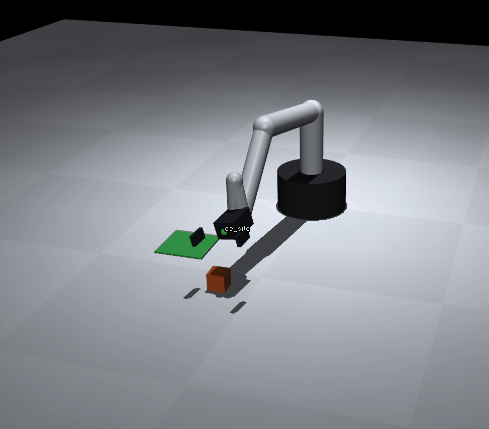

# mujoco_demo

初识 MuJoCo 的 demo：UR 型六自由度机械臂 + 二指夹爪，在 MuJoCo 里做随机方块抓取与放置（轨迹规划 + IK）。


## 功能

- 打招呼（wave）、趣味动作（dance）
- 随机方块抓取与放置（轨迹规划 + 逆运动学 IK）
- 自动连播模式（适合录屏演示）
- 轨迹规划后端：优先使用 Ruckig（jerk-limited），未安装时自动降级为 quintic 插值

## 环境要求

- Python 3.8+
- 操作系统：Windows / Linux / macOS 均可

## 安装

```bash
# 1. （推荐）创建并激活虚拟环境
python -m venv venv
# Windows:
venv\Scripts\activate
# Linux / macOS:
source venv/bin/activate

# 2. 安装依赖
pip install -r requirements.txt
```

> 可选：安装 Ruckig 以获得更平滑的轨迹规划（`pip install ruckig`）。不装也能正常运行。

## 运行

```bash
python demo_embodied_mujoco.py
```

启动后按提示输入命令：

| 按键 | 功能 |
|------|------|
| `1` | 机械臂打招呼 |
| `2` | 机械臂趣味动作 |
| `3` | 随机方块抓取与放置 |
| `4` | 自动连播模式 |
| `q` | 退出 |

### 命令行参数

| 参数 | 说明 |
|------|------|
| `--headless` | 无图形模式运行 |
| `--fast` | 关闭实时 sleep，加速执行 |
| `--autoplay` | 启动后先自动连播一次 |
| `--autoplay-rounds N` | 自动连播轮数，默认 2 |

示例：

```bash
# 无图形模式快速跑一遍
python demo_embodied_mujoco.py --headless --fast --autoplay --autoplay-rounds 1
```

## 常见问题

- **viewer 无法启动**：程序会自动回退到 headless 模式继续运行。图形窗口需要系统支持 GLFW/OpenGL。
- **`ImportError: mujoco`**：确认已执行 `pip install mujoco`。
