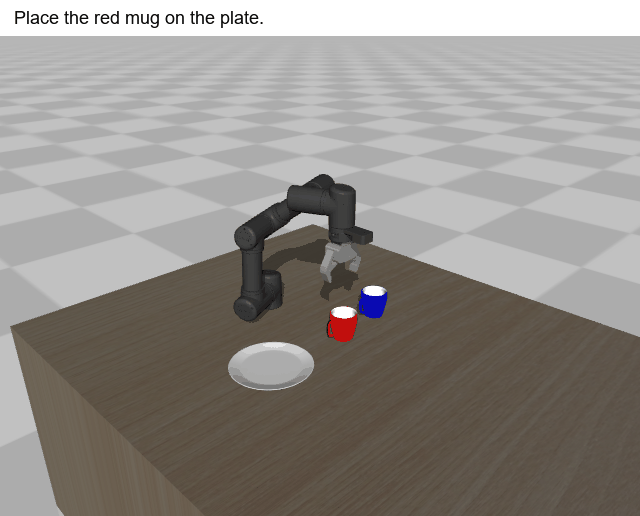
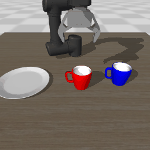
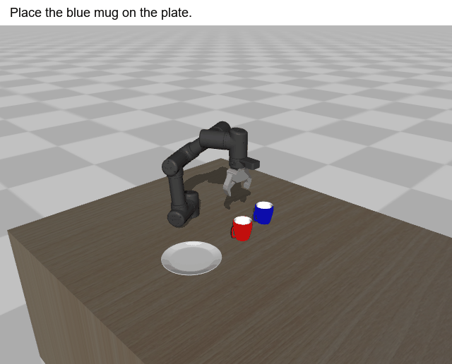
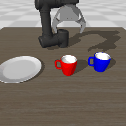
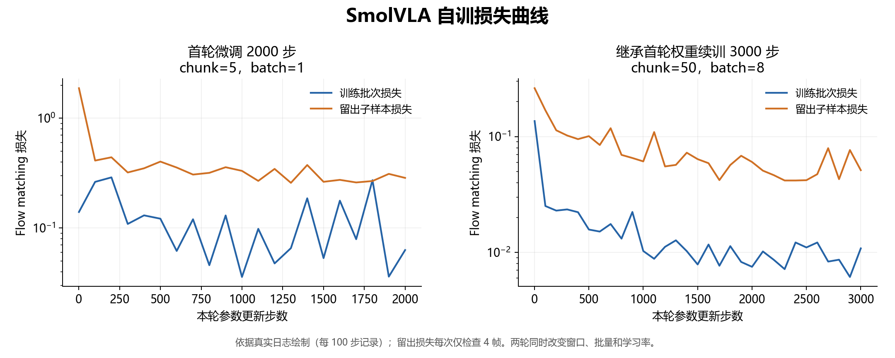
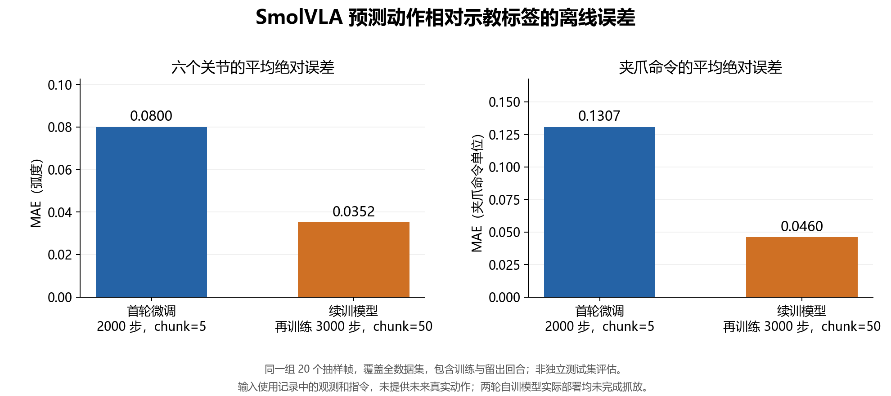
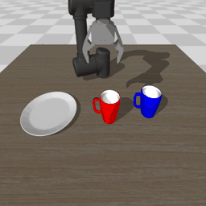

# LeRobot MuJoCo 训练 ACT、SmolVLA、Pi0 本机复现

本项目参考 [Every-Embodied 的 MuJoCo 教程](https://github.com/datawhalechina/every-embodied/blob/main/06-%E7%AD%96%E7%95%A5%E6%8A%93%E5%8F%96%E6%88%96%E6%8A%93%E5%8F%96VLA/%E5%A4%A7%E6%A8%A1%E5%9E%8B%E6%8E%A7%E5%88%B6%E3%80%81VLA%E3%80%81VLM/04mujoco%E5%A4%8D%E7%8E%B0ACT%E3%80%81Pi0%E3%80%81SmolVLA/README.md)，在 Windows 上逐步完成 OMY 机械臂的示教采集、数据回放、模型训练与仿真部署。

原始 Notebook 和场景保存在 [vendor/every_embodied](vendor/every_embodied/)，本机运行入口为 [run.py](run.py)。第一次学习可配合 [个人自学练习册](docs/LEARNER_GUIDE.md) 使用。

## 目录

- [安装](#安装)
- [更新计划](#更新计划)
- [1. 采集示教数据](#1-采集示教数据)
- [2. 回放数据](#2-回放数据)
- [3. 训练 Action-Chunking-Transformer（ACT）](#3-训练-action-chunking-transformeract)
- [4. 部署 ACT 策略](#4-部署-act-策略)
- [5-6. 语言条件环境中的采集与可视化](#5-6-语言条件环境中的采集与可视化)
- [模型与数据集](#模型与数据集)
- [7. 训练与部署 pi_0](#7-训练与部署-pi_0)
- [8. 训练与部署 SmolVLA](#8-训练与部署-smolvla)
- [9. 策略诊断与物理成功评估](#9-策略诊断与物理成功评估)
- [10. 用 π0.5 微调 OMY](#10-用-π05-微调-omy)
- [复现记录](#复现记录)
- [致谢](#致谢)

## 安装

本机使用 **Windows、Python 3.10、MuJoCo 3.1.6**，显卡为 **RTX 5060 Laptop，约 8GB 显存**。第 1～9 节沿用已有的 `my_env`，保留原有 PyTorch 和 torchvision；第 10 节单独使用 Python 3.12 环境。

以下命令均在**仓库根目录**的 PowerShell 中执行：

```powershell
Set-Location "C:\Users\32010\GitHub\replica_embodied"
$PythonExe = "$env:USERPROFILE\Apps\Anaconda\envs\my_env\python.exe"
$RunTag = Get-Date -Format "yyyyMMdd_HHmmss"
$SingleData = ".\mujoco_teleop\data\single_$RunTag"
$LanguageData = ".\mujoco_teleop\data\language_$RunTag"
$ActRun = ".\mujoco_teleop\checkpoints\act_$RunTag"
$ActLongRun = ".\mujoco_teleop\checkpoints\act_chunk100_$RunTag"
$SmolRun = ".\mujoco_teleop\checkpoints\smol_$RunTag"

# 新克隆项目时安装；当前机器已有 .deps，可跳过
& $PythonExe .\mujoco_teleop\scripts\install_dependencies.py

# 检查解释器、依赖、GPU 和场景资源
& $PythonExe .\mujoco_teleop\run.py doctor
```

新增依赖放在项目的 `.deps/`，由启动入口自动加载，不向 base 或 my_env 混装旧版 LeRobot。已有 `.deps` 时安装脚本会拒绝覆盖；不建议另外直接执行 `pip install lerobot`。

上述方式直接调用 Python，可用于 PowerShell 提示“禁止运行脚本”的情况。重新打开终端时，需要重新设置解释器和路径变量；再次采集或训练请使用新的目录。

盘子模型保留上游 ZIP，首次运行会离线解压。需要补齐或校验原始资源时执行：

```powershell
& $PythonExe .\mujoco_teleop\scripts\fetch_upstream.py
```

## 更新计划

- [x] OMY 场景与 Windows 独立运行入口
- [x] 单杯示教采集、数据保存与回放
- [x] ACT 训练与单杯抓放部署
- [x] 红杯、蓝杯语言条件数据采集与回放
- [x] SmolVLA 微调、部署与失败结果记录
- [x] 教程公开 SmolVLA 权重的红、蓝杯抓放验证
- [x] 数据质量审计、物理成功评估与整体复查
- [x] π0 运行条件检查、π0.5 数据转换与接口测试
- [ ] 自训 SmolVLA 完成稳定抓放
- [ ] π0、π0.5 完整模型训练与部署
- [ ] XR 设备验证

## 1. 采集示教数据

对应原教程 [1.collect_data.ipynb](vendor/every_embodied/1.collect_data.ipynb)。

使用 **ROBOTIS OMY 六轴机械臂及夹爪的 MuJoCo 仿真模型**，无需实体机械臂。任务是抓起杯子、移动到盘子上、松开夹爪并抬高末端。

键盘采集：

```powershell
& $PythonExe .\mujoco_teleop\run.py collect --dataset $SingleData --episodes 1
```

让 MuJoCo 窗口获得键盘焦点后操作：

- `W / A / S / D`：平面移动。
- `R / F`：上升、下降。
- `Q / E`、方向键：调整姿态。
- 空格：切换夹爪开合。
- `Z`：重置环境，丢弃当前未保存回合。
- `Esc`：退出。

环境判定成功后自动保存一条示教。数据目录已存在时会停止，不会删除旧数据；未成功的键盘回合不保存为成功示教。

<p align="center">
  
</p>
<p align="center">
键盘采集演示
</p>

也可以先用脚本生成一条示教，验证整个流程。**下面与键盘采集二选一**，不能向同一个已有目录重复采集：

```powershell
& $PythonExe .\mujoco_teleop\run.py auto-demo --dataset $SingleData
```

这一步由 IK 控制脚本执行真实仿真动作，不使用训练模型。本机成功样例为 **602 帧、20Hz、约 30.1 秒**。

数据按 LeRobot v2.1 格式保存，主要字段如下：

| 字段 | 内容 |
| --- | --- |
| `observation.image` | 场景相机图像，256×256×3 |
| `observation.wrist_image` | 腕部相机图像，256×256×3 |
| `observation.state` | 六维末端位姿：位置与欧拉角 |
| `action` | 六个绝对目标关节角 + 夹爪命令，0 开、1 闭 |
| `obj_init` | 杯子和盘子的初始位置 |
| `task` | 抓杯放盘的任务文字 |

保存的动作是实际下发的目标命令，观测在本帧命令下发前取得。另存初始物理状态，便于后续按相同条件回放。

## 2. 回放数据

对应原教程 [2.visualize_data-omy.ipynb](vendor/every_embodied/2.visualize_data-omy.ipynb)。

```powershell
& $PythonExe .\mujoco_teleop\run.py replay --dataset $SingleData --episode 0 --output ".\mujoco_teleop\outputs\replay_$RunTag"
```

回放会恢复场景初始状态，按保存的动作重新驱动机械臂。主窗口显示当前仿真，叠加图像来自采集时保存的相机画面。

<p align="center">
  
</p>
<p align="center">
采集demo回放演示
</p>

本机 602 帧样例完整回放，任务判定成功，末端位置对齐误差为 **0**。这是相同机器、版本和初始状态下的结果。

输出目录保留 JSON 报告与双相机图片。报告中的 `complete` 表示是否完整回放，`final_task_success` 表示最终是否完成任务。

## 3. 训练 Action-Chunking-Transformer（ACT）

对应原教程 [3.train.ipynb](vendor/every_embodied/3.train.ipynb)。

先准备附加依赖和官方 ResNet18 初始化权重，再使用第 1 节的数据训练：

```powershell
& $PythonExe .\mujoco_teleop\scripts\prepare_act.py
& $PythonExe .\mujoco_teleop\run.py train-act --dataset $SingleData --output $ActRun --steps 5000 --batch-size 64 --chunk-size 10
```

模型读取当前场景图像和末端位姿，预测接下来的关节与夹爪动作。上面的配置训练 **5,000 步**，本机记录约 **17 分钟**，实际耗时随机器和配置变化。

训练目录保存 `best/`、`final/` 权重，以及损失曲线、预测动作对比和配置记录。

<p align="center">
  
</p>
<p align="center">
training_loss
</p>
<p align="center">
  
</p>
<p align="center">
预测动作与示教动作对比
</p>

当前只有一条单杯示教，主要用于验证训练流程。离线动作误差下降后，还需要到下一节检查实际抓放。

<details>
<summary>Windows 训练注意事项</summary>

本地入口使用主进程读取数据，避免 Notebook 多进程的 PicklingError。显存不足时可减小 `--batch-size`；完整操作说明见 [个人自学练习册](docs/LEARNER_GUIDE.md)。

</details>

## 4. 部署 ACT 策略

对应原教程 [4.deploy.ipynb](vendor/every_embodied/4.deploy.ipynb)。

加载上一步权重，让模型根据实时观测控制机械臂：

```powershell
& $PythonExe .\mujoco_teleop\run.py deploy-act --checkpoint "$ActRun\final" --output ".\mujoco_teleop\outputs\act_baseline_$RunTag" --mode chunk --action-steps 10
```

本机 10 步动作窗口的模型停在杯子上方，没有完成抓放。在保留失败结果后，改用 100 步预测窗口，从原训练的 best 权重继续训练 2,000 步：

```powershell
& $PythonExe .\mujoco_teleop\run.py train-act --dataset $SingleData --output $ActLongRun --steps 2000 --batch-size 32 --chunk-size 100 --learning-rate 0.00005 --init-checkpoint "$ActRun\best"
& $PythonExe .\mujoco_teleop\run.py deploy-act --checkpoint "$ActLongRun\final" --output ".\mujoco_teleop\outputs\act_success_$RunTag" --mode chunk --action-steps 100
```

本机续训后的 final 权重在有窗口和无窗口模式下均完成抓放，杯子抬升约 **21cm**。部署动作来自模型预测，不回放示教，也不由脚本接管。

<p align="center">
  
</p>
<p align="center">
ACT 独立控制机械臂完成抓杯、搬运和放置
</p>

当前机器可直接运行 `& $PythonExe .mujoco_teleop
un.py deploy-act`，加载已有成功权重。该权重位于本机 `checkpoints/act_omy_chunk100/final`，不会随 Git 克隆下载。

ACT 的确认规则包含抬升超过 10cm、松爪、末端抬高和盘上连续保持 20 帧，未额外要求杯子竖直。成功验证使用与示教相同的 seed=0，尚不能说明泛化能力。

## 5-6. 语言条件环境中的采集与可视化

对应原教程：

- [5.language_env.ipynb](vendor/every_embodied/5.language_env.ipynb)：红、蓝双杯任务的数据采集。
- [6.visualize_data.ipynb](vendor/every_embodied/6.visualize_data.ipynb)：已采集数据的回放。

从单杯扩展到红杯、蓝杯两个任务，同时保存相机图像、关节状态、目标动作与任务文字。先生成 20 条脚本示教，再分别回放两种任务：

```powershell
& $PythonExe .\mujoco_teleop\run.py collect-language --dataset $LanguageData --episodes 20 --scripted --headless --fast
& $PythonExe .\mujoco_teleop\run.py replay-language --dataset $LanguageData --episode 0 --output ".\mujoco_teleop\outputs\red_$RunTag"
& $PythonExe .\mujoco_teleop\run.py replay-language --dataset $LanguageData --episode 1 --output ".\mujoco_teleop\outputs\blue_$RunTag"
```

手动采集时去掉 `--scripted --headless --fast`，键位与第 1 节一致。

**数据示例**

<p align="center">
  
  
</p>
<p align="center">
红杯任务的指令与回放画面
</p>
<p align="center">
  
  
</p>
<p align="center">
蓝杯任务的指令与回放画面
</p>

本机保存 **20 条、12,782 帧**，红杯与蓝杯各 10 条；全部轨迹回放的关节状态对齐误差为 0。进一步检查发现部分示教放置后杯子倾倒，第 9 节会单独审计。

**这里的六维状态是关节角，第 1 节则是末端位姿。** 两种数据不能只因维数相同就混用。

## 模型与数据集

### 获取语言条件数据集

第 7、8 节使用语言条件数据。本项目优先使用第 5～6 节自行采集并回放的数据；当前机器已有 `data/language_demo_020`，使用已有数据时设置：

```powershell
$LanguageData = ".\mujoco_teleop\data\language_demo_020"
```

新克隆项目没有这些本机数据，应先执行第 5～6 节。`data/`、`checkpoints/`、下载缓存和依赖目录均不随 Git 上传。

### 模型参考

| 模型 | 用途 | 本机结果 |
| --- | --- | --- |
| 本机 ACT 权重 | 单杯示教训练 | 100 步窗口续训后完成抓放 |
| [SmolVLA base](https://huggingface.co/lerobot/smolvla_base) | 自行微调的初始化权重 | 已完成微调，自训模型尚未完成抓放 |
| [OMY SmolVLA 微调权重](https://huggingface.co/Jeongeun/omy_pnp_smolvla) | 教程公开的任务模型 | 对齐接口后红、蓝杯物理成功 2/2 |
| [OMY pi_0 微调权重](https://huggingface.co/Jeongeun/omy_pnp_pi0) | 原教程模型参考 | 本机未部署 |
| [π0.5 base](https://huggingface.co/lerobot/pi05_base) | 第 10 节微调的初始化模型 | 本机仅完成数据准备 |

## 7. 训练与部署 pi_0

对应原教程 [训练配置](vendor/every_embodied/pi0_datawhale_eai.yaml) 与 [7.pi0.ipynb](vendor/every_embodied/7.pi0.ipynb)。

本机先执行模型导入、配置、访问权限和显存条件检查：

```powershell
& $PythonExe .\mujoco_teleop\scripts\check_vla.py --online --output ".\mujoco_teleop\outputs\pi_check_$RunTag.json"
```

固定版代码中的错误类型导入已修复，但**尚未进行完整训练或部署**：

- π0 实际使用的 PaliGemma 分词器访问返回 401，当前缺少可用授权凭据。
- 按真实模型参数估算，教程默认训练的权重、梯度及 Adam 状态约需 22.83GiB；仅训练动作专家的配置约需 8.80GiB，均未包含激活等开销。
- 本机 GPU 总容量约 7.93GiB，当前教程标准配置不满足条件；换 Ubuntu 或另开虚拟机不会增加物理显存。

估算来自 meta 设备参数统计，不是本机实际训练峰值。详细检查见 [π 模型诊断](docs/RECHECK_REPORT.md)。


## 8. 训练与部署 SmolVLA

对应原教程 [8.smolvla.ipynb](vendor/every_embodied/8.smolvla.ipynb)。

先下载固定版本预训练权重，再使用语言条件数据微调：

```powershell
& $PythonExe .\mujoco_teleop\scripts\prepare_vla.py
& $PythonExe .\mujoco_teleop\run.py train-smolvla --dataset $LanguageData --output $SmolRun --steps 2000 --batch-size 1 --chunk-size 5 --holdout-episodes 2 --log-every 100
& $PythonExe .\mujoco_teleop\run.py deploy-smolvla --checkpoint "$SmolRun\final" --output ".\mujoco_teleop\outputs\smol_self_$RunTag" --max-steps 1000
```

训练程序严格加载预训练参数，保留最后两个完整回合作为留出数据。模型读取两路图像、关节状态和任务文字，输出机械臂与夹爪动作。

本机完成了 **2,000 步短窗口微调**，以及在其基础上的 **3,000 步长窗口续训**。两组模型均可保存、加载和运行，但都未完成抓放；这些是本机练习配置，未执行上游 20,000 步、batch=16 的完整配置。

**训练日志**

<p align="center">
  
</p>

<p align="center">
  
</p>

**部署教程公开权重**

也可先体验教程已经微调好的 OMY 模型：

```powershell
& $PythonExe .\mujoco_teleop\scripts\prepare_vla.py --tutorial-checkpoint
& $PythonExe .\mujoco_teleop\run.py deploy-smolvla --checkpoint .\mujoco_teleop\.downloads\models\omy_pnp_smolvla --output ".\mujoco_teleop\outputs\smol_public_$RunTag" --upstream-interface --max-steps 1000
```

`--upstream-interface` 对齐原教程的夹爪映射、积分器，以及 800×600 渲染后缩放到 256×256 的相机流程。本机有窗口、无窗口验证均为红杯和蓝杯 **物理成功 2/2**，杯子保持竖直。

<p align="center">
  
  
</p>

<p align="center">教程公开 SmolVLA 权重执行红杯和蓝杯指令</p>

这项成功来自公开微调权重，与自训结果分别记录。两项 seed=0 任务用于当前场景验证，不作为泛化成功率。

## 9. 策略诊断与物理成功评估

对应原教程 [09策略诊断与物理成功评估.md](vendor/every_embodied/09策略诊断与物理成功评估.md)。

回放全部示教检查物理质量，并检查自训模型的动作误差与指令响应：

```powershell
& $PythonExe .\mujoco_teleop\run.py audit-language --dataset $LanguageData --output ".\mujoco_teleop\outputs\audit_$RunTag.json"
& $PythonExe .\mujoco_teleop\run.py diagnose-smolvla --dataset $LanguageData --checkpoint "$SmolRun\final" --output ".\mujoco_teleop\outputs\diagnose_$RunTag.json" --samples 20
```

物理检查要求目标杯实际抬升至少 3cm 并持续至少 3 帧、满足任务条件且保持竖直；部署还要求连续稳定 20 帧。本机 20 条示教均能通过原抓放检查，满足额外竖直放置要求的为 **12/20**。

SmolVLA 部署以 `physical_successes` 为主要结果。`successes` 保留旧 ACT 的额外高度条件，公开模型本次该值为 0，与物理成功 2/2 的评价口径不同。

> 【图片占位：杯子竖直与倾倒的对照，以及逐回合物理审计结果。】

需要重新检查主要链路时执行：

```powershell
& $PythonExe .\mujoco_teleop\scripts\recheck.py
```

最近复查完成 18 个阶段，20 项本地测试和 6 项 π0.5 数据接口测试通过，已有 ACT 与公开 SmolVLA 权重的抓放结果也再次通过验证。短步反向更新只用于检查程序链路；XR 相关 Notebook 已保留，尚未执行设备实验。

## 10. 用 π0.5 微调 OMY

对应原教程 [10.pi05_omy.ipynb](vendor/every_embodied/10.pi05_omy.ipynb)。

本机已完成这一节的**数据准备与接口测试**。使用独立的 **Python 3.12 / LeRobot 0.6.1** 环境，不升级第 1～9 节的旧环境：

```powershell
& $PythonExe .\mujoco_teleop\scripts\prepare_pi05.py
& .\mujoco_teleop\.venv-pi05\Scripts\python.exe .\mujoco_teleop\scripts\pi05_data.py test

# 源数据须先通过第 2 节回放，并核实目标动作标签
& .\mujoco_teleop\.venv-pi05\Scripts\python.exe .\mujoco_teleop\scripts\pi05_data.py prepare --source $SingleData --destination ".\mujoco_teleop\data\pi05_v3_$RunTag" --labels-verified
```

转换保留原数据，输出独立的 LeRobot v3 数据，并检查动作窗口与回合边界。本机已完成 **602 帧转换和 50 步动作窗口对齐**，6 项接口测试通过；输入仍为第 1 节的末端位姿数据，不能直接换成双杯关节状态数据。

> 【图片占位：LeRobot v3 数据目录、转换结果和动作窗口对齐报告。】

**尚未进行 π0.5 完整模型微调。** 当前独立环境是 CPU 数据测试环境，缺少完整模型依赖；上游训练依赖在 Windows 下还有 TorchCodec 版本冲突。上游另一次五步微调记录的峰值分配显存为 12.85GiB，超过本机容量，该数值不是本机实测或通用最低要求。

## 复现记录

- [个人自学练习册](docs/LEARNER_GUIDE.md)：逐步操作、预期效果与每一步的作用。
- [采集与回放记录](docs/REPRODUCTION_LOG.md)：第 1～2 节的环境配置和问题处理。
- [ACT 复现记录](docs/ACT_REPRODUCTION_LOG.md)：第 3～4 节的训练、失败对照与成功配置。
- [VLA 复现记录](docs/VLA_REPRODUCTION_LOG.md)：语言数据、SmolVLA 与 π0.5 数据验证。
- [整体复查与 π 模型诊断](docs/RECHECK_REPORT.md)：复跑结果及当前无法按教程训练 π 模型的具体原因。

原始教程固定提交为 `14d7c6c93debf01419b21e50b649a06f15881c38`，第 1～9 节 LeRobot 固定提交为 `10b7b3532543b4adfb65760f02a49b4c537afde7`。原始文件保存在 `vendor/`，本地适配在 `src/omy_repro/`；来源校验见 [upstream_manifest.json](upstream_manifest.json)，依赖、数据、大权重与运行输出由 Git 忽略，源码和小型验证记录随仓库保存。

## 致谢

- 复现流程参考 [Datawhale Every-Embodied](https://github.com/datawhalechina/every-embodied)。
- OMY 机械臂资源来自 [ROBOTIS MuJoCo Menagerie](https://github.com/ROBOTIS-GIT/robotis_mujoco_menagerie)。
- 模型训练与数据接口使用 [Hugging Face LeRobot](https://github.com/huggingface/lerobot)。
- MuJoCo Parser 参考 [yet-another-mujoco-tutorial-v3](https://github.com/sjchoi86/yet-another-mujoco-tutorial-v3)。
- 杯子与盘子资源来自 [Objaverse](https://objaverse.allenai.org/)。
- 其他来源与授权说明见 [THIRD_PARTY_NOTICES.md](THIRD_PARTY_NOTICES.md)。
