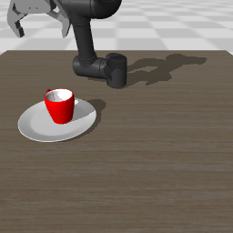

# OMY 示教采集、回放与 ACT 训练部署（Every-Embodied 第 1～4 部分）

在 Windows 上复现 OMY 六轴机械臂的键盘示教采集和动作回放。使用教程原始机械臂、杯子、盘子、场景与逆运动学代码；提供独立 Python/PowerShell 入口，避免 Notebook 的工作目录、Windows 多进程和误删数据问题。

本项目范围：第 1 部分采集示教、第 2 部分回放数据、第 3 部分 ACT 训练、第 4 部分 ACT 仿真部署。**不包含 SmolVLA 训练或真机控制。** ACT 是视觉模仿学习策略，本实验不加入语言理解。

另提供 `auto-demo`：以确定性 IK 脚本执行一次抓杯、抬升、搬运、放下，再保存实际仿真轨迹，方便无需手工操作就验证第 1、2 部分。它不是训练出来的 VLA 策略，也不是人类键盘示教。

## 来源与版本

- [上游教程](https://github.com/datawhalechina/every-embodied/tree/14d7c6c93debf01419b21e50b649a06f15881c38/06-%E7%AD%96%E7%95%A5%E6%8A%93%E5%8F%96%E6%88%96%E6%8A%93%E5%8F%96VLA/%E5%A4%A7%E6%A8%A1%E5%9E%8B%E6%8E%A7%E5%88%B6%E3%80%81VLA%E3%80%81VLM/04mujoco%E5%A4%8D%E7%8E%B0ACT%E3%80%81Pi0%E3%80%81SmolVLA)
- Every-Embodied 固定提交：`14d7c6c93debf01419b21e50b649a06f15881c38`。
- LeRobot 固定提交：`10b7b3532543b4adfb65760f02a49b4c537afde7`，数据格式 v2.1。
- 来源文件清单、大小与 Git blob SHA-1：[`upstream_manifest.json`](upstream_manifest.json)。
- 原始 Notebook、环境代码与模型资源保存在 [`vendor/every_embodied/`](vendor/every_embodied/)。上游代码保持原样，本地适配集中在 `src/omy_repro/`。
- 复现操作记录见 [`docs/REPRODUCTION_LOG.md`](docs/REPRODUCTION_LOG.md)，第三方来源与授权见 [`THIRD_PARTY_NOTICES.md`](THIRD_PARTY_NOTICES.md)。
- 第 3、4 部分独立记录见 [`docs/ACT_REPRODUCTION_LOG.md`](docs/ACT_REPRODUCTION_LOG.md)。

## 当前机器的环境选择

使用已有 `my_env` 的 Python 3.10，不使用 base 的 Python 3.14。检测到 NVIDIA RTX 5060 Laptop GPU（约 8 GB 显存），保留已有 PyTorch `2.14.0+cu130` 与 torchvision `0.29.0+cu130`。第 1、2 部分不需要 GPU 训练；第 3、4 部分默认使用 CUDA。

旧版 LeRobot 需要旧版 `datasets/fsspec`。为保留用户环境，新增依赖安装在本项目 `.deps/` 中，由 `run.py` 启动时加载。**没有新建虚拟环境，也不把项目依赖安装进 base/my_env 的 site-packages。** 普通终端直接 `import mujoco` 不会加载 `.deps`，请使用下述入口。

`environment-before.json` 保存复现前 my_env 的包版本；`.deps` 不进入 Git。克隆项目后需要运行安装脚本，项目内的模型、源码会随 Git 保留。

## 快速运行（Windows PowerShell）

在仓库根目录执行。`run.ps1` 优先寻找现有的 `my_env` 解释器，不依赖故障的 `conda.exe`。

```powershell
# 查看解释器、依赖与场景资源
.\mujoco_teleop\run.ps1 doctor

# 先回放本机已生成的成功抓放轨迹
.\mujoco_teleop\run.ps1 replay --dataset .\mujoco_teleop\data\scripted_demo_004

# 第 1 部分：手动采集一条成功示教；路径相对于当前终端
.\mujoco_teleop\run.ps1 collect --dataset .\mujoco_teleop\data\my_first_demo --episodes 1

# 第 2 部分：回放刚才保存的第 0 条示教
.\mujoco_teleop\run.ps1 replay --dataset .\mujoco_teleop\data\my_first_demo --episode 0
```

如果 PowerShell 执行策略阻止脚本，不必修改系统策略，可以直接使用解释器：

```powershell
& "$env:USERPROFILE\Apps\Anaconda\envs\my_env\python.exe" .\mujoco_teleop\run.py doctor
& "$env:USERPROFILE\Apps\Anaconda\envs\my_env\python.exe" .\mujoco_teleop\run.py collect --episodes 1
& "$env:USERPROFILE\Apps\Anaconda\envs\my_env\python.exe" .\mujoco_teleop\run.py replay --episode 0
```

省略 `--dataset` 时，正式采集和回放都使用 `mujoco_teleop/data/demo_data`。采集路径已存在会报错退出，**不会删除或覆盖旧示教**；再次采集请换一个新目录。

## 第 1 部分：键盘采集

窗口打开后，先点击 MuJoCo 窗口使其获得焦点。键盘控制沿用教程：

| 按键 | 作用 |
| --- | --- |
| W / S、A / D | 在桌面平面移动末端 |
| R / F | 上升 / 下降 |
| Q / E、方向键 | 调整末端姿态 |
| 空格 | 切换夹爪开合 |
| Z | 放弃当前未保存回合，重置机器人和物体 |
| Esc / 关闭窗口 | 退出；未成功的回合不作为成功示教保存 |

操作目标：靠近杯子 → 调整高度和夹爪方向 → 抓起杯子 → 移到盘子上 → 松开夹爪 → 抬高末端。按教程的 `check_success()` 判定成功后自动保存。只打开窗口或移动机械臂，并不表示抓放成功。

采集频率为 **20 Hz**；每条记录的观测在下发本帧动作前取得，随后推进 0.05 秒仿真：

| 字段 | 形状 / 含义 |
| --- | --- |
| `observation.image` | `256×256×3`，场景相机 RGB |
| `observation.wrist_image` | `256×256×3`，腕部相机 RGB |
| `observation.state` | `float32[6]`，末端位置和欧拉角 |
| `action` | `float32[7]`，6 个绝对目标关节角 + 夹爪命令，0 开 / 1 闭 |
| `obj_init` | `float32[6]`，杯子和盘子的初始位置 |
| `task` | `Put mug cup on the plate`，通过任务索引关联 |

动作来自 `get_commanded_joint_action()`，不是 `step()` 返回的观测。执行控制前将关节目标统一为数据实际保存的 float32，IK 求解后恢复完整积分状态（含求解器热启动状态），避免未保存的浮点精度或 IK 副作用影响回放。保留图像到 Parquet，避免依赖外部 FFmpeg；原始 PNG 也保留，便于检查，不做自动清理。

## 第 2 部分：数据回放

回放读取本地 LeRobot v2.1 数据，恢复初始物理状态后，按 20 Hz 将动作下发到同一 OMY 场景。窗口的图像叠层显示**采集时保存的相机图像**，机器人主体显示当前回放仿真。结束后输出 JSON 报告和回放末帧的双相机图片。

```powershell
# 无主窗口地验证回放；仍需要可工作的 OpenGL/桌面驱动
.\mujoco_teleop\run.ps1 replay --dataset .\mujoco_teleop\data\my_first_demo --headless --fast
```

`complete=true` 表示动作序列完整回放；`final_task_success` 表示末帧是否满足上游任务判定。这两个指标含义不同。`max_next_observation_position_error_m` 比较回放动作后的末端位置与下一条原始观测。

额外的 `initial_states/*.npz` 保存 MuJoCo 积分状态，便于从相同状态开始回放；这是本地扩展，不改变 LeRobot 的标准字段。不带该文件的上游数据仍可按 `obj_init` 回放，物理轨迹可能存在差异。

## 自动抓放并采集实际轨迹

```powershell
# 打开窗口，观看抓放并保存数据（新目录）
.\mujoco_teleop\run.ps1 auto-demo --dataset .\mujoco_teleop\data\my_auto_demo
.\mujoco_teleop\run.ps1 replay --dataset .\mujoco_teleop\data\my_auto_demo

# 无主窗口、加速执行同一控制流程
.\mujoco_teleop\run.ps1 auto-demo --dataset .\mujoco_teleop\data\another_auto_demo --headless --fast
```

默认 `seed=0` 是本机验证配置。脚本只通过机械臂关节和夹爪控制物体，不在运行过程中修改杯子位置或附加吸附约束。结束时同时检查杯子实际抬升超过 10 厘米、上游成功判定成立，才保存成功回合；失败不会伪装成成功示教。20 Hz、602 帧约对应 30.1 秒仿真。

上游成功判定检查杯盘位置距离、夹爪松开和末端抬高，不要求杯子保持竖直。当前样例仅用于单场景流程验证，不能作为模型泛化或严格放置质量的指标。

运行后可在 `outputs/scripted_preview.gif` 观看采集动画。采集结果与回放结果的截图、详细指标见本项目 `docs/`。

本机最终验证：`data/scripted_demo_004`，602 帧（30.1 秒），杯子实际抬升约 **20.69 厘米**；采集与回放的任务判定均成功；本次回放的末端位置对齐误差为 **0.0 米**。这是同一机器、版本和种子下的记录，不承诺跨机器逐位一致。

| 采集末帧 | 回放末帧 |
| --- | --- |
|  |  |

这条数据和所有调试数据保存在当前本机的 `data/`，不会随 Git 上传。在其他机器克隆后，运行 `auto-demo` 可重新生成。

## 自动检查采集—保存—回放链路

不需要手工操作的 `smoke` 模式只让机械臂小幅上下运动，生成**明确标记为 smoke 的接口测试数据**，不能用于声称完成抓杯实验或训练成功。再次运行时更换目录。

```powershell
.\mujoco_teleop\run.ps1 smoke --dataset .\mujoco_teleop\data\smoke_check --headless --fast --frames 40
.\mujoco_teleop\run.ps1 replay --dataset .\mujoco_teleop\data\smoke_check --headless --fast
```

`--headless` 指不打开主窗口，仍会渲染相机图像；当前适配依赖上游的 GLFW/显示器检测，不保证可在完全没有显示服务的 Linux 服务器运行。

## 第 3 部分：训练 ACT

在已有第 1、2 部分环境上，先补齐 ACT 附加依赖并缓存官方 ResNet18 初始化权重：

```powershell
& "$env:USERPROFILE\Apps\Anaconda\envs\my_env\python.exe" .\mujoco_teleop\scripts\prepare_act.py
```

首次运行需要网络下载 torchvision 官方骨干网络权重，后续训练和部署读取本地缓存。没有替换已有 PyTorch，也不需要在 base 里安装包。

```powershell
# 新克隆或本机没有数据时，先执行此命令生成训练示教；已有同名目录则跳过
.\mujoco_teleop\run.ps1 auto-demo --dataset .\mujoco_teleop\data\scripted_demo_004 --headless --fast

# 完整训练；再次训练时使用一个新的 --output 目录
.\mujoco_teleop\run.ps1 train-act --dataset .\mujoco_teleop\data\scripted_demo_004 --output .\mujoco_teleop\checkpoints\act_omy_5000 --steps 5000 --batch-size 64
```

沿用教程的 ACT 架构、10 步动作块、Adam 1e-4、图像噪声 0.02。输入为单路场景相机与 6 维末端位姿；不使用腕部相机。输出为 10×7 的关节目标和夹爪命令。使用 BF16 混合精度；显存不足时可以减小 `--batch-size`，`--no-amp` 可关闭混合精度。

输出目录保留：

- `training_run.json`：数据哈希、实际配置、步数、显存峰值、耗时和离线指标。
- `metrics.jsonl`、`training_loss.png`：每步 loss 和训练曲线。
- `offline_actions.npz/png`：离线动作预测与示教标签的对比。
- `best/config.json`、`best/model.safetensors`：按离线 MAE 选择的 checkpoint。
- `final/`：第 5000 步的最终 checkpoint。

**只有一个训练回合，当前任务属于单场景拟合。** 离线评估只传入当前观测，明确排除真值未来动作；MAE 降低不能代替真实闭环抓放成功。7 维总体 MAE 混合关节弧度与夹爪单位，判断精度时应查看报告中的分维度指标。

## 第 4 部分：部署训练好的 ACT

```powershell
# 当前机器：直接观看已验证成功的 ACT 部署
.\mujoco_teleop\run.ps1 deploy-act

# 原教程 10 步配置的时间集成对照（本机没有完成抓放）
.\mujoco_teleop\run.ps1 deploy-act --checkpoint .\mujoco_teleop\checkpoints\act_omy_5000\final --output .\mujoco_teleop\outputs\act_my_rollout --mode ensemble --ensemble 0.9

# 每次执行模型预测的 10 步动作块
.\mujoco_teleop\run.ps1 deploy-act --checkpoint .\mujoco_teleop\checkpoints\act_omy_5000\best --output .\mujoco_teleop\outputs\act_my_chunk_rollout --mode chunk --action-steps 10 --headless --fast
```

部署只读取实时图像和末端位姿，动作完全来自加载的 ACT 权重，不回放示教、不使用 IK 控制脚本接管。程序严格加载完整 checkpoint，缺权重即停止，不允许随机初始化伪装为部署成功。

输出目录已有时拒绝覆盖。部署最多执行 `--max-steps` 帧（默认 1200）；`--trials N` 依次使用 `seed` 到 `seed+N-1`。每个 trial 会清空策略动作队列/时间集成状态。

`deployment_report.json` 分别记录上游任务判定与更严格的抓放确认：实际抬升超过 10 厘米、夹爪命令不超过 0.1、末端高度至少 0.95 m，并在盘上连续保持 20 帧。逐帧动作、状态和图片保存在相同目录。默认 seed=0 与训练示教相同；不同种子不保证成功，不能把同种子结果当作泛化评测。

### 本机结果与成功配置

原教程的 10 步模型完成了 5000 步训练，但 best/final 在时间集成和动作块模式都停在杯子上方，未完成抓放。完整负结果保存在 [`docs/act_baseline/`](docs/act_baseline/)。

在不改变示教数据、输入和 ACT 主体结构的情况下，扩大预测窗口到 100 步，并继承训练权重继续训练 2000 步：

```powershell
.\mujoco_teleop\run.ps1 train-act --dataset .\mujoco_teleop\data\scripted_demo_004 --output .\mujoco_teleop\checkpoints\act_omy_chunk100 --steps 2000 --batch-size 32 --chunk-size 100 --learning-rate 0.00005 --init-checkpoint .\mujoco_teleop\checkpoints\act_omy_5000\best

.\mujoco_teleop\run.ps1 deploy-act --checkpoint .\mujoco_teleop\checkpoints\act_omy_chunk100\final --output .\mujoco_teleop\outputs\act_my_success --mode chunk --action-steps 100
```

共享网络权重严格加载；动作 query 位置嵌入按新长度插值，固定 VAE 位置编码相应扩展。这个工程适配同时增加了训练步数，不是只比较窗口长度的严格消融实验。

当前 `deploy-act` 默认加载 **`act_omy_chunk100/final`**，按 checkpoint 中的动作步数执行。100 步动作块意味着每 5 秒仿真重新查询一次模型，中间以 20 Hz 执行模型已预测的动作。`select_action` 的耗时统计包含缓存动作和首次 CUDA 初始化，不能当作纯模型单次推理延迟。

本机 seed=0 的验证结果：

| 验证 | 完成帧数 | 杯子最大抬升 | 松爪后连续保持 | 严格抓放确认 |
| --- | --- | --- | --- | --- |
| 无主窗口 | 586 | 21.03 cm | 20 帧 | 通过 |
| 有窗口 | 572 | 21.23 cm | 20 帧 | 通过 |

两次均使用 ACT 神经网络控制，没有示教回放或 IK 接管。长窗口的 `best` 虽然离线误差更低，却没有通过抓放，因此默认使用实际验证通过的 `final`。这些是同一训练场景的两次运行，不能解释为跨场景成功率。


详细训练、失败对照、OpenGL 上下文修正和验证过程见 [`ACT_REPRODUCTION_LOG.md`](docs/ACT_REPRODUCTION_LOG.md)。

训练权重约 206 MB，留在本机 `checkpoints/`，不直接提交到 GitHub；新机器需要先训练或复制完整 checkpoint 目录再部署。

## 新机器安装 / 恢复依赖

需要 Python 3.10 和可用的 PyTorch / torchvision。现有机器的 GPU 版 PyTorch 沿用用户环境，不在本章安装脚本中替换。安装脚本优先读取实际安装后生成的 `requirements-lock.txt`；`requirements.txt` 说明直接依赖，LeRobot 另外按固定提交安装。

```powershell
& "$env:USERPROFILE\Apps\Anaconda\envs\my_env\python.exe" .\mujoco_teleop\scripts\install_dependencies.py
```

安装脚本只在 `.deps` 不存在时执行，避免覆盖正在使用的依赖。下载失败后可保留 `.downloads` 缓存，再按照日志检查实际安装状态。不同平台需要重新安装依赖，不能把 Windows `.deps` 直接复制到 Ubuntu。

若要校验上游原始资源，或资源被遗漏：

```powershell
& "$env:USERPROFILE\Apps\Anaconda\envs\my_env\python.exe" .\mujoco_teleop\scripts\fetch_upstream.py
```

该脚本校验 Git blob 哈希，遇到现存文件被改动会报错，不会覆盖。盘子资源由上游 ZIP 解压，解压时检查路径，已有文件不覆盖。

运行回归检查（需要 OpenGL，测试会创建并清理自己的临时数据）：

```powershell
& "$env:USERPROFILE\Apps\Anaconda\envs\my_env\python.exe" .\mujoco_teleop\tests\test_reproduction.py
& "$env:USERPROFILE\Apps\Anaconda\envs\my_env\python.exe" .\mujoco_teleop\tests\test_act.py
& "$env:USERPROFILE\Apps\Anaconda\envs\my_env\python.exe" .\mujoco_teleop\tests\test_rendering.py
```

检查现存数据保护、动作标签语义、完整积分状态恢复、IK 的物理副作用以及 Parquet 图像/动作的保存与读取。

## 文件布局与 Git 管理

```text
mujoco_teleop/
  README.md                    安装、操作、数据格式与限制
  run.py / run.ps1             启动入口
  requirements.txt            第 1、2 部分的直接依赖
  upstream_manifest.json      固定上游版本和原始资源校验值
  environment-before.json     原有环境快照
  scripts/                    依赖安装、上游资源获取
  src/omy_repro/              本地采集、回放、环境适配
  tests/                      数据/动作/状态恢复回归检查
  vendor/every_embodied/       原始 Notebook、环境代码、OMY/杯盘模型
  docs/                       复现日志、验证结果
  .deps/                      本地依赖，Git 忽略
  .downloads/                 下载和运行缓存，Git 忽略
  data/                       采集数据，Git 忽略
  outputs/                    回放报告和截图，Git 忽略
```

本次工作在 `codex/omy-collection-replay` 分支开发，并按用户要求上传到 `103xu/replica_embodied`。较大的示教、运行缓存不进入 Git，源码和必要模型资源保留在本仓库中。原有 `mujoco_demo/` 保持原样。

第 3、4 部分在 `codex/act-training-deployment` 分支继续开发。采集/回放、ACT 和 GUI 相机一致性共 11 项检查通过；实际部署结果单独记录，不以单元测试通过替代抓放成功判定。

盘子的原始 OBJ 网格较大，因此 Git 保留上游的 `plate_11.zip`，解压目录通过 `.gitignore` 排除；当前本机保留解压后的完整模型，首次从 Git 克隆运行时会自动离线解压，不需要重新下载。这样避免直接提交大型原始网格。
