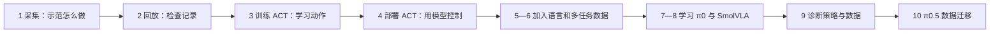
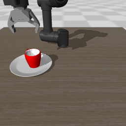

# 我的具身智能复现练习册：从机械臂示教到理解 VLA

> 用途：给你自己动手学习用。可以边看边运行，不要求你先读懂所有源码。
>
> 这份是自学操作指导；已有 README 提供参数，复现日志记录实验事实。将来给老师或其他人看的报告可以另外写。

## 先确定这次要学什么

我们沿着你选中的 Every-Embodied 教程 **「MuJoCo 复现 ACT、π0、SmolVLA」** 学习。这里的模块编号对应这篇教程，不要求你把整个 Every-Embodied 仓库里的所有项目都安装一遍。

做完前四个模块，你应该能亲手走通：**准备示教数据 → 检查数据 → 训练策略 → 让策略控制机器人**。这是后续复现 VLA 很重要的一条基础链路。

先记住三个名字：

| 名字 | 在这次练习中负责什么 |
| --- | --- |
| MuJoCo | 模拟机械臂、杯子、盘子和碰撞，让我们不买机械臂也能做实验 |
| LeRobot | 帮我们整理机器人数据、训练策略和保存模型的工具库 |
| ACT | 根据图像和机器人状态预测一段动作的模仿学习策略 |

**本次 ACT 不使用语言来决定动作。** 之后的 π0、SmolVLA 才是本教程里学习语言条件 VLA 的对象。你现在不需要先训练一个语言大模型。



当前进度与练习范围：

| 原教程模块 | 当前本地状态 | 你现在可以做什么 |
| --- | --- | --- |
| 1．采集示教 | 已实现并验证 | 生成脚本示教；尝试键盘操作 |
| 2．回放数据 | 已实现并验证 | 读取数据并在仿真中回放 |
| 3．训练 ACT | 已实际训练 | 查看已有结果；自己重新训练 |
| 4．部署 ACT | 已实际验证抓放 | 运行已经训练的模型，检查实际成功条件 |
| 5．语言条件采集 | 已采集 20 条红/蓝杯示教 | 生成双任务数据，理解关节状态与语言标签 |
| 6．语言条件可视化 | 已验证回放 | 对照指令、物体、动作与终态 |
| 7．π0 训练与部署 | 配置检查通过；训练、部署未完成 | 检查资源与模型访问条件 |
| 8．SmolVLA 训练与部署 | 公开 OMY 权重两种指令物理成功；自训模型仍失败 | 先体验发布权重，再比较自训与部署 |
| 9．策略诊断 / XR 扩展 | 已接入数据与策略诊断；XR 未运行 | 审计全部示教，区分语言敏感性与任务成功 |
| 10．π0.5 微调 OMY | 已完成独立环境中的数据迁移与接口测试 | 检查 v3 数据；完整模型微调尚未完成 |

下面区分本机实际运行的命令与尚未完成的模型实验。π0、π0.5 的完整训练受资源或访问条件限制；SmolVLA 已有真实训练和部署记录，任务效果以报告为准。上游 README 目录未列第 9 节，但源文件中包含策略诊断文档和 XR Notebook，这里已补全。

**第一次建议这样安排：** 第一次完成模块 0–2，看见示教和回放；第二次完成模块 3–4，比较训练与部署；第三次从模块 5 开始学习语言数据和 SmolVLA，随后做诊断及 v3 转换。想先看看模型实际控制是什么样，可以完成模块 0 后直接体验 4.4，再回头学习数据和训练。

想先看真正带语言输入的 VLA，可以完成模块 0 后直接运行 8.6，它会准备所需依赖和公开 OMY 权重。本机已验证红、蓝指令都能完成物理任务；它不是自己这轮训练产生的模型。

---

## 模块 0：先把终端和环境用对

### 0.1 你当前可以继续用 Windows

这份指导面向你现在这台电脑：Windows、RTX 5060 Laptop GPU、约 8GB 显存。前四个模块已经在这台机器验证过，继续在 Windows 上操作即可。

我们使用现有 `my_env` 的 Python 3.10。项目新增的依赖放在 `mujoco_teleop/.deps/`，运行入口会加载它们。不要因为某个包报错，就立刻在 base 里升级一遍所有依赖。

### 0.2 打开 PowerShell，先复制这一整段

下面几行只是设置当前终端中的路径变量，不会修改系统环境变量或 PowerShell 执行策略。

```powershell
Set-Location "C:\Users\32010\GitHub\replica_embodied"
$StudyPython = "C:\Users\32010\Apps\Anaconda\envs\my_env\python.exe"
$StudyTag = Get-Date -Format "yyyyMMdd_HHmmss"
$StudyData = ".\mujoco_teleop\data\scripted_demo_004"
$StudyPracticeData = ".\mujoco_teleop\data\learn_demo_$StudyTag"
$StudyManualData = ".\mujoco_teleop\data\learn_keyboard_$StudyTag"
$StudyAct10 = ".\mujoco_teleop\checkpoints\learn_act10_$StudyTag"
$StudyAct100 = ".\mujoco_teleop\checkpoints\learn_act100_$StudyTag"
$StudyDeploy = ".\mujoco_teleop\outputs\learn_deploy_$StudyTag"
```

这里的 `$StudyPython` 指向你的 Python；`$StudyTag` 给本轮练习生成一个新名字，避免覆盖之前的数据或权重。后面把它们当作路径简称即可。

**本指导后续命令在同一个 PowerShell 窗口运行。** 如果关掉窗口重新打开，需要先重新执行这段初始化。复制命令时，不要把终端提示符 `PS C:\...>` 一起复制。

如果要接着上一次练习继续，重新初始化后，还要把 `$StudyTag` 设回上次的标签，再重新设置相关路径变量；也可以直接把命令中的数据、模型路径替换为上次保存的真实目录。新的标签会指向新目录，不会自动找到上次训练的模型。

### 0.3 检查环境

```powershell
& $StudyPython .\mujoco_teleop\run.py doctor
```

开头的 `&` 是 PowerShell 用来启动这个 Python 程序的符号。我们直接启动 Python，因此不会遇到你之前 `.ps1` 被执行策略拦截的问题。

**预期看到：** 输出中包含 Python 3.10、`cuda_available: true`、你的 NVIDIA 显卡名称、`scene_exists: true`。

**这一步在做什么：** 确认后面的训练会用到正确的解释器、依赖、GPU 和场景文件。它没有开始训练，也没有让机器人执行任务。

如果这一关没有通过，先看文末的故障表，再继续。

### 0.4 看一眼当前机器保留了哪些成果

```powershell
Test-Path "$StudyData\meta\info.json"
Test-Path ".\mujoco_teleop\checkpoints\act_omy_chunk100\final\model.safetensors"
```

在当前机器上，这两项应当都为 `True`：前者是已经验证过的示教，后者是已经验证过的 ACT 权重。

数据和大权重没有上传 GitHub。换电脑重新克隆时，它们可能是 `False`，那时需要生成数据、训练模型，或者复制完整的本地 checkpoint 目录。

---

## 模块 1：采集示教——先告诉机器人“正确动作是什么”

对应参考教程：`1.collect_data.ipynb`。

### 1.1 先用脚本完成一条示教

为了让你顺利开始，先用已经验证的控制脚本采集，不必第一次就熟练操作键盘。

```powershell
& $StudyPython .\mujoco_teleop\run.py auto-demo --dataset $StudyPracticeData
```

**预期看到：** MuJoCo 窗口打开，机械臂靠近杯子、闭爪、抬起、搬到盘子上、松爪、抬臂。成功后终端报告保存了 1 个 episode，并显示数据目录。

`episode` 可以先理解为“一次完整尝试”。本机已验证样例有 602 帧，采样频率 20Hz，大约对应 30.1 秒仿真。你这一轮应以实际输出为准。

窗口打开后先观察，不用按键控制。想加速采集时可以用下面这个版本，**两条命令选择一条执行即可**：

```powershell
& $StudyPython .\mujoco_teleop\run.py auto-demo --dataset $StudyPracticeData --headless --fast
```

`--headless` 不打开主窗口，但仍会渲染相机图像；`--fast` 不刻意等待真实时间。第一次建议使用能看见窗口的版本。

**这一步在做什么：** 控制脚本给出动作，MuJoCo 执行物理仿真，同时记录每一步的画面、状态和动作。这条示教可以用来教一个神经网络。

**现在还没有发生什么：** 机械臂这次成功不代表 ACT 已经学会了。当前负责动作的是写好的 IK 控制脚本。IK 的作用是把“末端想移动到哪里”转成关节目标。

### 1.2 看看保存的数据

```powershell
$StudyInfo = Get-Content "$StudyPracticeData\meta\info.json" -Raw | ConvertFrom-Json
$StudyInfo | Select-Object robot_type, fps, total_episodes, total_frames
Get-Content "$StudyPracticeData\meta\tasks.jsonl"
```

**预期看到：** 机器人类型为 OMY、频率为 20、回合数为 1，以及这条示教的帧数；任务文字类似 `Put mug cup on the plate`。

先认识下面这些内容就够了：

| 记录内容 | 可以怎样理解 |
| --- | --- |
| 场景相机图像 | 机器人这一刻看到了什么 |
| 腕部相机图像 | 靠近夹爪的相机看到了什么 |
| `observation.state` | 末端的位置与姿态，共 6 个数 |
| `action` | 6 个目标关节角和 1 个夹爪命令，共 7 个数 |
| 任务文字 | 这条示教想完成什么 |

这里的“状态”和“动作”不是同一组数。末端位置用米表示；目标关节角用弧度表示。动作是**绝对目标关节角**，不能当作“每一步再增加多少角度”。

夹爪命令 0 表示打开，1 表示闭合，中间值表示程度。图像与状态在准备本帧动作前取得，这样模型才能学习“看到这些信息后，下一步应该发什么动作”。

主要数据表保存在 Parquet 文件里，不需要用记事本读它。入门时先看 JSON 元信息和下一模块的回放。

### 1.3 再尝试自己操作一次（选做）

```powershell
& $StudyPython .\mujoco_teleop\run.py collect --dataset $StudyManualData --episodes 1
```

先点击 MuJoCo 窗口，使它获得键盘焦点：

| 按键 | 作用 |
| --- | --- |
| W / S、A / D | 在桌面平面移动末端 |
| R / F | 上升 / 下降 |
| Q / E、方向键 | 调整末端姿态 |
| 空格 | 切换夹爪开合 |
| Z | 放弃当前尚未保存的尝试并重置 |
| Esc | 退出 |

抓住杯子、放到盘子上、松爪并抬高末端，满足成功判定后才自动保存。终端显示保存了 0 个 episode，就还没有获得成功示教。第一次手动没成功，也可以先用脚本数据继续学习。

**本模块过关问题：** 这条数据是谁示范的？每帧记录了什么？机械臂成功一次，为什么还不能证明神经网络学会了？

---

## 模块 2：回放数据——检查“记录对不对”

对应参考教程：`2.visualize_data-omy.ipynb`。

### 2.1 回放刚才采集的脚本示教

```powershell
& $StudyPython .\mujoco_teleop\run.py replay --dataset $StudyPracticeData --episode 0 --output ".\mujoco_teleop\outputs\learn_replay_$StudyTag.json"
```

`episode 0` 是第一条回合，编号从 0 开始。

**预期看到：** 机械臂根据保存的动作再次运动。结束后生成 JSON 报告和相机末帧图片。

窗口中的机器人主体是当前回放仿真；图像叠层显示采集时保存的图像。不要只看叠层中的杯子已经到盘子上，就认为当前仿真也一定成功。

```powershell
Get-Content ".\mujoco_teleop\outputs\learn_replay_$StudyTag.json"
```

先看三个字段：

| 字段 | 怎样理解 |
| --- | --- |
| `complete` | 保存的动作是否全部执行完 |
| `final_task_success` | 回放末帧是否满足任务条件 |
| `max_next_observation_position_error_m` | 回放末端位置与原记录下一帧位置的最大偏差，单位是米 |

完整回放和完成任务是两个判断。比如一个失败动作序列也能被完整回放。

**这一步在做什么：** 检查保存、读取、动作定义和仿真接口是否对应。数据不对，后面的训练很难补救。

### 2.2 确认后面统一使用的训练数据

你刚才生成的数据保存在 `$StudyPracticeData`。为了先减少变量，后续训练主线使用本机已经验证过的 `$StudyData`，即 `scripted_demo_004`。

```powershell
Test-Path "$StudyData\meta\info.json"
```

当前机器应为 `True`。如果是新克隆且没有这份数据，可以让后面的训练改用你刚生成的成功示教：

```powershell
$StudyData = $StudyPracticeData
```

这行只在确实需要换数据时执行。**记住自己的训练命令到底用了哪个目录**，否则很容易把不同数据的结果混在一起。

**本模块过关问题：** 回放时有没有神经网络预测动作？如果保存的动作标签错了，为什么光看训练 loss 不够？

---

## 模块 3：训练 ACT——让模型学习“看到什么就怎么动”

对应参考教程：`3.train.ipynb`。

### 3.1 准备训练依赖

```powershell
& $StudyPython .\mujoco_teleop\scripts\prepare_act.py
```

**预期看到：** ACT 所需依赖和 ResNet18 初始化权重准备完成。首次需要联网；当前机器已有缓存时会复用。

ACT 会利用一个预训练视觉骨干提取图像特征，然后学习机器人动作。因此这里并非所有参数都从完全随机状态开始。

### 3.2 正式训练原教程的 10 步配置

```powershell
& $StudyPython .\mujoco_teleop\run.py train-act --dataset $StudyData --output $StudyAct10 --steps 5000 --batch-size 64
```

**预期看到：** 终端持续输出训练步数、loss 和离线动作误差，结束时出现 `TRAINING_COMPLETE`。

本机上一次完整训练约用了 17 分钟，实际时间取决于机器负载。这里训练 5000 步，是做 5000 次参数更新，不是采集 5000 条示教。

这几个参数先这样理解：

| 参数 | 含义 |
| --- | --- |
| `--dataset` | 从哪一份示教学习 |
| `--output` | 本轮模型与日志保存在哪里 |
| `--steps 5000` | 更新模型参数 5000 次 |
| `--batch-size 64` | 每次更新抽取 64 个训练样本 |
| 默认 `chunk-size=10` | 一次预测未来 10 个控制步的动作 |

采样频率是 20Hz，10 步大约对应 0.5 秒动作。模型学的是“一段动作”，而不只是一个关节角数字。

本实验模型的输入、输出如下：

```text
输入：当前场景相机图像 + 当前末端位置和姿态
输出：未来 10 步，每步 6 个目标关节角 + 1 个夹爪命令
```

虽然数据保存了腕部图像和任务文字，这个 ACT 配置只使用场景相机和末端位姿。**数据里有一列文字，不等于模型已经使用语言。**

### 3.3 训练究竟做了什么

每次更新可以先理解成四步：

1. 从示教中取出某一刻的画面、状态和后面的正确动作。
2. 让 ACT 预测动作。
3. 比较预测和示教标签，计算训练损失。
4. 调整网络参数，让它以后预测得更接近示教。

本 ACT 训练还包含 VAE 的 KL 项。入门阶段先知道：**终端的总 loss 不只是动作误差**。看动作是否准确时，也要看 `l1_loss`、离线动作对比和实际部署。

### 3.4 查看自己产出的东西

```powershell
Get-Content "$StudyAct10\training_run.json"
Get-ChildItem "$StudyAct10\best"
Get-ChildItem "$StudyAct10\final"
```

你应当得到：

| 文件 | 用途 |
| --- | --- |
| `training_run.json` | 记录这次用了什么数据、参数、耗时和误差 |
| `training_loss.png` | 看训练损失的变化趋势 |
| `offline_actions.png` | 看模型预测和示教标签的动作曲线是否接近 |
| `config.json` | 模型结构、输入输出、动作窗口等配置 |
| `model.safetensors` | 真正学到的模型权重 |

`best` 是按离线误差选出的 checkpoint；`final` 是最后一步保存的 checkpoint。`checkpoint` 可以理解成“能重新加载的一份模型存档”。后面会看到，离线 best 不一定最会抓杯。

### 3.5 如果你暂时不想等完整训练

可以先读本机已保存的 [训练记录](act_baseline/training_run.json)、[损失曲线](act_baseline/training_loss.png)、[动作对比图](act_baseline/offline_actions.png)，然后在模块 4 使用已有权重体验。

如果只想检查训练程序能否运行，可以另建一个短练习目录执行 20 步：

```powershell
& $StudyPython .\mujoco_teleop\run.py train-act --dataset $StudyData --output ".\mujoco_teleop\checkpoints\learn_check_$StudyTag" --steps 20 --batch-size 16 --eval-every 20
```

20 步检查通过只能说明训练链路能运行，不能当作完成了 5000 步训练或学会抓放。后面的 `$StudyAct10` 仍然指正式训练目录；若跳过正式训练，就使用模块 4 明确标出的“已有权重体验”命令。

**本模块过关问题：** 模型输入里有哪些信息？动作标签来自哪里？训练时能看示教标签，部署时还能把未来真值动作喂给模型吗？

---

## 模块 4：部署 ACT——检查“模型自己做得怎么样”

对应参考教程：`4.deploy.ipynb`。

### 4.1 先测试原教程配置

如果你完成了模块 3 的正式训练，运行：

```powershell
& $StudyPython .\mujoco_teleop\run.py deploy-act --checkpoint "$StudyAct10\final" --output ".\mujoco_teleop\outputs\learn_act10_$StudyTag" --mode ensemble --ensemble 0.9 --max-steps 1000
```

**预期现象：** 机器人由 ACT 预测动作。本机先前的这个配置虽然离线误差很低，却停在杯子上方，没有完成抓放。你的结果应以本轮报告为准。

这里的 `ensemble` 是把多次预测中对应同一时刻的动作做加权合并，目的是让动作更平滑。它不会自动解决数据或策略本身的问题。

**这一步和回放的区别：** 回放读取已经保存的动作；部署只读取当前画面和状态，再由模型给出动作。不要用回放成功代替部署成功。

### 4.2 用本机验证过的长窗口方案继续训练

参考教程的 10 步配置是对照；接下来使用 ACT 原生支持的 100 步窗口，并从刚才的模型继续训练：

```powershell
& $StudyPython .\mujoco_teleop\run.py train-act --dataset $StudyData --output $StudyAct100 --steps 2000 --batch-size 32 --chunk-size 100 --learning-rate 0.00005 --init-checkpoint "$StudyAct10\best"
```

**预期看到：** 先加载已有权重，再继续优化 2000 步，保存新的 `best`、`final`、曲线和报告。本机此前续训约用了 5 分钟。

100 步大约覆盖 5 秒动作，可以把示教中的部分等待和后续动作放在同一个预测窗口里。我们保留这个方法，是因为本机实际部署通过了；同时它增加了训练步数，因此不能只凭这一次实验就断言“成功完全由窗口变长导致”。

这一步是对 ACT 的继续训练，还没有加入语言，也不是在微调一个 VLA。

### 4.3 部署自己训练的长窗口模型

```powershell
& $StudyPython .\mujoco_teleop\run.py deploy-act --checkpoint "$StudyAct100\final" --output $StudyDeploy --mode chunk --action-steps 100 --max-steps 1000
```

**预期看到：** 机器人尝试抓杯、搬运、放下、松爪和抬臂。先前验证的 final 权重在当前场景完成了这些动作，但你新一轮训练仍需亲自检查报告，不能把旧结果算作自己的新结果。

100 步动作块的执行方式是：用当前观测预测一段动作，按 20Hz 执行这段动作，再用新的观测预测下一段。**控制命令每秒发送 20 次，不表示神经网络每秒重新预测 20 次。** 当前设置每执行 100 步重新查询一次模型。

### 4.4 已有权重体验：现在就能看见的成功路径

如果你还没正式重训，或者想先检查运行环境，用这条命令。它加载的是本机已经验证过的权重，不是你本轮尚未生成的模型。

```powershell
& $StudyPython .\mujoco_teleop\run.py deploy-act --checkpoint ".\mujoco_teleop\checkpoints\act_omy_chunk100\final" --output ".\mujoco_teleop\outputs\learn_existing_$StudyTag" --mode chunk --action-steps 100 --max-steps 1000
```

本机此前有窗口验证的末帧：



[观看当时保存的部署动画](act_horizon100/act_confirmed_gui_fixed.gif)。这张图和动画是已保存的实验记录；你自己这次的结果保存在新输出目录。

### 4.5 怎样判定真的完成了

自己的长窗口部署结束后，查看：

```powershell
Get-Content "$StudyDeploy\deployment_report.json"
```

如果使用的是“已有权重体验”，报告路径对应它的输出目录：

```powershell
Get-Content ".\mujoco_teleop\outputs\learn_existing_$StudyTag\deployment_report.json"
```

| 关注内容 | 要看什么 |
| --- | --- |
| `checkpoint` | 确认加载的到底是哪一份权重 |
| `grasp_successes` | 本次有多少次通过严格抓放确认 |
| `mug_lift_height_m` | 杯子是否真的被抬起来 |
| `stable_success_frames` | 松爪抬臂后是否持续满足放置条件 |
| 相机末帧与动画 | 有没有推出去、没抓住或画面异常的情况 |

当前严格确认要求杯子抬升超过 10 厘米、夹爪充分打开、末端抬到至少 0.95 米，并连续满足放置条件 20 帧。上游判定不要求杯子保持竖直，所以如果你想评价放得好不好，也应亲自检查画面。

本机已有权重在相同训练场景的有窗口、无窗口验证中都通过了确认。这说明它能做这个练习，不能据此说它已经会处理各种位置、杯子和指令。

### 4.6 这一步最值得理解的地方

离线评估时，每一步给模型的都是示教里原本的画面和状态。真正部署时，前一步动作偏了一点，下一步看到的东西也可能变了。因此“离线预测很准”和“自己连续执行成功”不是一个结果。

我们还遇到过：离线误差更低的 `best` 抓放失败，误差稍高的 `final` 反而成功。选机器人策略时，应同时检查动作误差和实际执行结果。

**本模块过关问题：** 怎样证明这次动作来自 ACT 而不是回放？为什么 loss 低还可能抓不起来？为什么只跑 seed=0 不能证明泛化？

---

## 模块 5：语言条件采集——同一个场景，根据指令选择杯子

对应原教程 `5.language_env.ipynb`。现在已接入 `collect-language`。

先在模块 0 初始化过的同一个 PowerShell 中添加这些路径：

```powershell
$StudyLanguageData = ".\mujoco_teleop\data\language_demo_020"
$StudyLanguagePractice = ".\mujoco_teleop\data\learn_language_$StudyTag"
$StudySmolPractice = ".\mujoco_teleop\checkpoints\learn_smol_$StudyTag"
$StudyPi05Python = ".\mujoco_teleop\.venv-pi05\Scripts\python.exe"
```

### 5.1 先看已经采集的数据

```powershell
Get-Content "$StudyLanguageData\meta\tasks.jsonl"
Get-Content "$StudyLanguageData\meta\info.json" -TotalCount 15
```

**预期：** 20 条回合、12,782 帧、20Hz，包含红杯、蓝杯两种指令。每个 seed 对应一条红杯和一条蓝杯示教，位置相同，任务不同。这些数据目前保存在本机，GitHub 中只有程序和小报告。

**这一步在做什么：** 让数据建立“这句话要求操作哪个物体”的对应关系。单杯任务里只有一种做法，双杯任务才开始需要区分目标。

### 5.2 自己重新采集一份

```powershell
& $StudyPython .\mujoco_teleop\run.py collect-language --dataset $StudyLanguagePractice --episodes 20 --scripted --headless --fast
```

**预期：** 终端交替显示红杯、蓝杯任务，每完成一条才保存一条，最后显示 `saved_episodes: 20`。每条回合的预览 GIF 和初始物理状态保存在该数据目录的 `initial_states/` 中。需要观看窗口时去掉 `--headless --fast`；20 条有窗口实时采集会更久。

当前脚本会检查目标杯确实抬起至少 10cm、放到盘上、松爪并抬臂。这个检查**还不要求杯子竖直**，请继续做模块 9 的审计。脚本示教成功，仍然不表示 VLA 模型已经学会。

需要把整个机械臂和桌面任务区域录进 GIF 时，在 `collect-language` 命令末尾加 `--overview-preview`。它使用独立的 640×480 展示相机，并在上方显示指令；训练数据中的两路 256×256 图像保持原样。`replay-language` 也支持此参数，用于从已有示教生成全景回放动画。采集 GIF 仍保存在数据目录的 `initial_states/`，回放 GIF 保存在指定输出目录。

如果是新克隆且没有已有数据，采集完成后设置：

```powershell
$StudyLanguageData = $StudyLanguagePractice
```

想手动采集可用 `collect-language --dataset 新目录 --episodes 2`，不加 `--scripted`；按键与模块 1 类似，依次完成红杯、蓝杯指令。手动模式需要有窗口。

**与模块 1 最容易混淆的地方：** 这次 `observation.state` 的 6 个数是**关节角**，模块 1 的 6 个数是**末端位姿**。数字数量相同不代表含义相同。单杯 ACT 数据与双杯 VLA 数据分开存放。

**过关问题：** 同一画面下，两句话对应什么不同动作？你保存的是人类示教、脚本示教，还是模型执行轨迹？

---

## 模块 6：语言条件回放——核对指令与动作

对应原教程 `6.visualize_data.ipynb`。先分别回放两种任务：

```powershell
& $StudyPython .\mujoco_teleop\run.py replay-language --dataset $StudyLanguageData --episode 0 --output ".\mujoco_teleop\outputs\learn_red_$StudyTag"
& $StudyPython .\mujoco_teleop\run.py replay-language --dataset $StudyLanguageData --episode 1 --output ".\mujoco_teleop\outputs\learn_blue_$StudyTag"
```

**预期：** 第一条操作红杯，第二条操作蓝杯。窗口显示的是当前仿真相机；每次结束保存 `replay_report.json`、两张末帧图和 `replay.gif`。两条命令依次运行。

```powershell
Get-Content ".\mujoco_teleop\outputs\learn_red_$StudyTag\replay_report.json"
Get-Content ".\mujoco_teleop\outputs\learn_blue_$StudyTag\replay_report.json"
```

主要检查 `instruction`、`complete`、`max_next_joint_state_error_rad`、`strict_success`、`upright`。本机前两条的关节状态回放误差为 0；其中蓝杯末态有倒杯现象。这是应该保留的数据质量问题，不能只看 `strict_success: true`。

**这一步在做什么：** 确认“指令标签、物体、动作、保存时序”一致。此时没有神经网络。

**过关问题：** 为什么“放到了盘子附近”和“稳定竖直放好了”需要分开评价？

---

## 模块 7：π0——先做配置和资源检查

对应 `7.pi0.ipynb`。本机已接入源码和配置，**尚未完成 π0 训练或部署**。

```powershell
& $StudyPython .\mujoco_teleop\scripts\repair_pi0_import.py
& $StudyPython .\mujoco_teleop\scripts\check_vla.py --output ".\mujoco_teleop\outputs\learn_vla_preflight_$StudyTag.json"
```

**预期：** π0 和 SmolVLA 配置能够解析，并检查真实模型导入、π0 架构的 meta 内存估算、π0.5 环境是否完整。第一条修正固定 LeRobot 中错误的 `pytest.Cache` 类型导入，只修改项目 `.deps`；重复执行不会重复修改，准备 VLA 环境时也会自动处理。加 `--online` 可以用 π0 源码实际使用的分词器调用检查当前凭据是否能读取 PaliGemma；不会下载大型模型权重。

本机当前分词器访问返回 401，且当前进程没有 Hugging Face 凭据。这需要使用已获 PaliGemma 访问权限的账号与凭据，反复安装 Python 包不能解决授权。

显存也有独立限制：实际 π0 架构的权重约 7.02GiB；按当前参数类型估算，教程默认配置的权重、梯度、Adam 状态约 22.83GiB，只训练动作专家也约 8.80GiB，尚未计入激活与工作区。本机总显存为 7.93GiB。这是 meta 参数估算，不是实际训练峰值或 OOM 测试；也不代表所有量化、LoRA 或卸载方案都不可能。

更完整的依据和 Windows 依赖问题见 [代码复查与 π 模型诊断](RECHECK_REPORT.md)。诊断命令退出成功，只代表检查跑完；不代表 `pi0_ready_under_tutorial_defaults` 已经为真。

**这一步在做什么：** 区分“配置写对了”“模型能访问”“模型能加载”“能训练”“会完成任务”这五件事。不要在 `my_env` 里反复升级包来尝试绕过资源或访问条件。

上游的 `train_model.py` 与 YAML 保存在 `vendor/every_embodied/`，供以后在合适环境中接续。当前无需为了这一节重新装 Ubuntu 虚拟机。

---

## 模块 8：SmolVLA——实际加载预训练 VLA 并微调

对应 `8.smolvla.ipynb`。现在已有本地训练、重新加载和双指令部署入口。

### 8.1 准备依赖和预训练文件

```powershell
& $StudyPython .\mujoco_teleop\scripts\prepare_vla.py
```

这一步需要联网。附加依赖装在项目 `.deps`，模型装在 `.downloads/models`。下载使用固定 revision，并核对大文件 SHA256。SmolVLA checkpoint 已包含视觉语言骨干的参数，因此骨干目录只需配置和分词器，不用再单独下载一套大权重。

**这一步在做什么：** 取来别人预训练过的视觉、语言、动作网络，再适配 OMY。不是从随机网络学整个 VLA。本地加载会检查所有核心参数是否匹配，失败时停止，避免把随机初始化误当作微调。

固定版 SmolVLA 配置的 `load_vlm_weights` 默认是 `False`；只写策略类型并构造网络，不保证已经加载预训练参数。因此这里额外明确加载官方完整 checkpoint。

### 8.2 先做五步检查

```powershell
& $StudyPython .\mujoco_teleop\run.py train-smolvla --dataset $StudyLanguageData --output ".\mujoco_teleop\checkpoints\learn_smol_check_$StudyTag" --steps 5 --batch-size 1 --holdout-episodes 2 --log-every 1
```

**预期：** 打印有限的 loss 和梯度，产生 `final/` 与 `training_run.json`，报告动作专家参数更新、抽查的冻结视觉参数保持不变。本机已验证五步链路；五步不用于证明抓放能力。

### 8.3 做一轮本机练习训练

```powershell
& $StudyPython .\mujoco_teleop\run.py train-smolvla --dataset $StudyLanguageData --output $StudySmolPractice --steps 2000 --batch-size 1 --holdout-episodes 2 --log-every 100
```

本机这轮配置约用 7 分钟、峰值分配显存约 2.14GB。输入是两路图像、六维关节状态和指令；输出是绝对关节目标与夹爪命令。最后两条完整回合留作评估，归一化统计量只从训练回合计算。

**与上游配置的区别：** 上游为 20,000 步、batch=16；这里为 2,000 步、batch=1，属于本机练习配置。两者的更新次数和见过的样本量都不同，不能写成“原配置完整训练已经复现”。

训练时冻结视觉语言骨干，更新约 1 亿个动作专家与投影参数。输出中的 `heldout_flow_loss` 是流匹配损失，不能直接当作“关节角误差多少弧度”；关节误差由下一模块单独测量。

当前日志的留出 loss 只测最多 4 个固定抽样帧，便于快速观察；不是整个留出集的平均误差，更不是抓放成功率。

### 8.4 让模型分别执行红、蓝指令

自己完成 8.3 后运行：

```powershell
& $StudyPython .\mujoco_teleop\run.py deploy-smolvla --checkpoint "$StudySmolPractice\final" --output ".\mujoco_teleop\outputs\learn_smol_deploy_$StudyTag" --max-steps 1000
Get-Content ".\mujoco_teleop\outputs\learn_smol_deploy_$StudyTag\deployment_report.json"
```

想直接测试本机已有的 2,000 步权重，把 `--checkpoint` 改成 `.\mujoco_teleop\checkpoints\smolvla_omy_2000\final`。无窗口加速测试可以加 `--headless --fast`。

**预期：** 程序依次在相同初始场景执行红杯、蓝杯指令，输出报告、逐帧动作、末帧图和 GIF。这里动作只来自 SmolVLA，没有脚本接管。

新版报告同时显示 `physical_successes`（第 9 节的抬升 3cm、持续与竖直规则，再稳定 20 帧）和 `successes`（原有 ACT 额外 10cm 检查）。主要看前者，并复核视频。默认按 `physical` 规则停止；要重跑原 10cm 对照，可加 `--success-rule strict`。两套口径不要混在一起比较。

**已知结果：** 2,000 步、5 步动作窗口的模型，两条指令都没有完成严格抓放。机器人动起来、loss 下降和 checkpoint 能重新加载，均不等于任务成功。较长动作窗口的后续实验见 [VLA 复现记录](VLA_REPRODUCTION_LOG.md)。

20Hz 是仿真的控制时间频率；模型推理较慢时，墙钟时间可以更久。默认每执行一个动作块再查询模型，报告里的平均动作调用耗时也包含从队列取动作的调用。

### 8.5 长窗口对照：从已有模型继续学习

完成自己的 2,000 步训练后，可以继续：

```powershell
$StudySmolLong = ".\mujoco_teleop\checkpoints\learn_smol_long_$StudyTag"
& $StudyPython .\mujoco_teleop\run.py train-smolvla --dataset $StudyLanguageData --init-checkpoint "$StudySmolPractice\final" --output $StudySmolLong --steps 3000 --batch-size 8 --chunk-size 50 --learning-rate 0.00005 --holdout-episodes 2 --log-every 100
& $StudyPython .\mujoco_teleop\run.py deploy-smolvla --checkpoint "$StudySmolLong\final" --output ".\mujoco_teleop\outputs\learn_smol_long_$StudyTag" --max-steps 1000
```

50 步动作块覆盖 2.5 秒，比原来的 5 步（0.25 秒）能看到更长的示教后续。这里载入已有模型参数，重新建立优化器；不是恢复原训练优化器状态。窗口、批量和训练次数都改变了，不能只把结果变化归因于窗口。

本机已通过 batch=8、chunk=50 的五步检查，峰值分配显存约 3.1GB；3,000 步续训的最终结果与耗时见复现记录。每次新训练仍需重新部署检查。

这轮 3,000 步续训实际约用 37.6 分钟，离线动作误差降低，但红、蓝任务仍未成功。保留这个结果，是为了让你看清“更低误差”和“能连续完成任务”的区别。

### 8.6 教程公开权重的独立对照（选做）

这条路线使用教程作者已经针对 OMY 微调的模型，与自己的训练结果分开：

```powershell
& $StudyPython .\mujoco_teleop\scripts\prepare_vla.py --tutorial-checkpoint
& $StudyPython .\mujoco_teleop\run.py deploy-smolvla --checkpoint ".\mujoco_teleop\.downloads\models\omy_pnp_smolvla" --output ".\mujoco_teleop\outputs\learn_smol_public_$StudyTag" --max-steps 1000 --upstream-interface
```

这两条命令可以单独执行：准备脚本会安装项目附加依赖，并下载约 1.2GB 的公开权重与骨干配置/分词器，固定版本并校验 SHA256。已经准备好依赖时可加 `--skip-install`。不必为了体验发布模型先下载通用 base；自己训练时再做 8.1。公开模型针对其原数据训练，实际结果单独保存，不能记成自己训练的成功。

这里的 `--upstream-interface` 使用上游 `SimpleEnv2` 原夹爪映射、积分器，以及 800×600 渲染后缩放到 256×256 的相机流程。移除它可以对照本地修正接口，但输出要另起目录。自己的模型继续使用采集时的默认接口，不要随意交换。张量形状相同，控制含义或相机视野仍可能不同。

**本机预期结果：** seed=0 红杯、蓝杯均通过物理成功检查，报告 `physical_successes: 2`，杯子保持竖直。红杯曾抬升约 6.5cm、蓝杯约 11.6cm。旧 ACT 额外规则的 `successes: 0` 与这个结果并不冲突。先复核视频，再读 [详细记录](VLA_REPRODUCTION_LOG.md)。这两个同场景结果不能当作广泛泛化能力。

已保存的有窗口运行：[红杯动画](vla_results/smolvla_tutorial_gui_seed0_red.gif)、[蓝杯动画](vla_results/smolvla_tutorial_gui_seed0_blue.gif)。它们是发布权重的真实模型动作。

**过关问题：** ACT 和这次 SmolVLA 的输入区别在哪里？预训练参数与本任务归一化统计量为什么要分开处理？

---

## 模块 9：策略诊断——证明学到了什么，也看清失败

对应上游 `09策略诊断与物理成功评估.md`。本次补上了上次指导遗漏的第 9 部分。

### 9.1 审计全部示教，而不只挑一条成功画面

```powershell
& $StudyPython .\mujoco_teleop\run.py audit-language --dataset $StudyLanguageData --output ".\mujoco_teleop\outputs\learn_language_audit_$StudyTag.json"
Get-Content ".\mujoco_teleop\outputs\learn_language_audit_$StudyTag.json"
```

这会按保存的动作重新做真实物理仿真，检查全部回合。重点对比 `strict_successes` 和 `physical_successes`。

前者要求实际抬升、松爪抬臂、接近盘子；后者按本次明确实现的物理评价规则，检查原任务条件、抬升至少 3cm 持续至少 3 个控制步、最终竖直轴余弦至少 0.85。两个规则并非完全包含关系。终态竖直的要求可发现倒杯示教，检查结果可能比“已保存条数”少。

### 9.2 测量离线动作误差和语言敏感性

```powershell
& $StudyPython .\mujoco_teleop\run.py diagnose-smolvla --dataset $StudyLanguageData --checkpoint "$StudySmolPractice\final" --output ".\mujoco_teleop\outputs\learn_smol_diagnosis_$StudyTag.json" --samples 20
```

跳过正式训练时，改为本机已有 checkpoint。这次检查不给模型未来真值动作；它在示教图像上预测第一步，再与标签比较。同时固定图像、状态和随机噪声，只替换红/蓝指令，再重复一次红指令。

本机 2,000 步模型的抽样关节误差约 0.080 rad；更换文字会改变预测，重复同一句话的预测一致。**这证明输入路径对文字有响应，仍不能证明选对了杯子。** 最终要回到模块 8 的实际执行和成功报告。

### 9.3 关于 XR 扩展

目录里还有 `9.teleop_xr.ipynb` 与 `9.teleop_xr-纯环境.ipynb`，它们是另一条 XR 遥操作扩展，需要 TeleopXR 源码、对应机器人资源与 XR 设备。原文件含作者本机路径 `C:\tbxr_real`，当前没有这套设备和路径，因此只保留源码，没有声称已运行。完成当前键盘与脚本示教主线不依赖 XR。

---

## 模块 10：π0.5——在独立环境中完成数据迁移

对应 `10.pi05_omy.ipynb`。这节已完成本机 **CPU 数据准备与接口测试**，没有完成 π0.5 模型微调或部署。

### 10.1 使用独立 Python 3.12

当前机器已经建好 `.venv-pi05`，其中是 Python 3.12.13、LeRobot 0.6.1、CPU 版 PyTorch。它与 `my_env` 分开。

这个环境没有安装完整 `lerobot[pi]` 模型依赖；实际构造模型会提示缺少 `transformers`。这不影响下文的数据与接口测试，但不能拿它直接执行 GPU 微调。上游完整依赖还存在 Windows 冲突：固定 `torchcodec==0.4.0`，而 LeRobot 0.6.1 在 Windows 上要求 `torchcodec>=0.7.0`。完整训练环境需要单独适配，不能直接照抄该文件，也不要升级现有 `my_env` 来混装两个版本。

新克隆需要恢复这个数据测试环境时运行（当前机器不需要反复安装）：

```powershell
& $StudyPython .\mujoco_teleop\scripts\prepare_pi05.py
```

脚本通过本机已有的 `uv` 安装独立解释器与锁定依赖。这里只准备数据接口，不是完整的 π0.5 GPU 训练环境。

### 10.2 运行上游接口测试

```powershell
& $StudyPi05Python .\mujoco_teleop\scripts\pi05_data.py test
```

**预期：** `Ran 6 tests`、`OK`。覆盖数据转换、图像与动作保真、回合边界、时序，以及权重加载失败时拒绝随机初始化回退。这些是程序测试，不是六次机器人任务成功。

### 10.3 把已回放的单杯数据转换为 v3

这条路线需要模块 1 的**末端位姿状态数据**，不能拿模块 5 的关节状态数据替代。本机已另行采集并回放过 `pi05_single_001`，共 602 帧。使用它生成一份新的转换结果：

```powershell
& $StudyPi05Python .\mujoco_teleop\scripts\pi05_data.py prepare --source ".\mujoco_teleop\data\pi05_single_001" --destination ".\mujoco_teleop\data\learn_pi05_v3_$StudyTag" --labels-verified
```

`--labels-verified` 表示你已经检查并回放了动作标签，不是让程序修复标签。新机器没有此源数据时，先用模块 1 的 `auto-demo` 采集到新目录，再回放通过，并将上面 `--source` 改成那个目录。

**预期：** 新目录出现 v3 数据和 `omy_manifest.json`；显示 602 帧、50 步动作窗口对齐检查通过，保留原数据。只有一条回合时没有独立留出集，因此这是接口检查，不能据此计算泛化成功率。

程序会打印将来 GPU 训练可使用的参数列表，**没有自动启动训练**。上游 π0.5 五步检查曾分配约 12.85GB 显存；本机只有约 8GB，目前不进行其完整训练。无需为此升级现有 `my_env`，也不能把转换成功记成 VLA 微调成功。

---


## 做完后，用这张表检查自己的理解

你可以用自己的话写答案，不用背术语：

| 问题 | 最低应该说清楚什么 |
| --- | --- |
| MuJoCo 在这里做什么？ | 提供机器人与物体的物理仿真 |
| 示教数据是什么？ | 在某些观察下，示范者执行了哪些动作 |
| 回放与部署有什么区别？ | 一个读取已有动作，一个让模型预测动作 |
| 训练产生什么？ | 可重新加载的配置和模型权重，以及用于检查的记录 |
| ACT 这次看到了什么？ | 场景图像、末端位姿；没有使用语言指令 |
| 动作块是什么？ | 一次预测一段未来动作，可按其中若干步执行后重新预测 |
| 为什么低 loss 不一定成功？ | 连续执行时输入会受自己先前动作影响，数据和实际任务也可能有差距 |
| 复现 VLA 还要补什么？ | 语言条件数据、确实使用语言的策略、输入输出对齐和真实部署评估 |
| 怎样证明 VLA 使用了语言？ | 在合适的同一场景中对比不同指令，检查物体选择，而不只看是否机械臂动了 |
| 为什么一条成功示教不够证明泛化？ | 训练未覆盖更多位置、物体、任务和干扰情况 |

如果你能独立运行一轮、指出数据目录和模型目录，并解释这些问题，就已经建立了继续复现 VLA 的基础。

## 给自己留一页练习记录

每次练习记这几项，比只截图“运行成功”更有帮助：

```text
本次目标：
使用的数据目录：
使用的模型目录：
我运行的主要命令：
训练的步数、批量大小、动作窗口：
我实际看到了什么：
报告是否显示抓放成功：
与上一次相比只改了什么：
遇到的问题和处理方法：
我现在能解释的一个新概念：
```

这是给自己理解和复查用的记录。面向老师的实验报告可以后续从这些事实中另行整理。

---

## 卡住时，先按症状找问题

| 看到的情况 | 先怎么做 |
| --- | --- |
| `.ps1` 被禁止执行 | 用本文的 `& $StudyPython ...` 命令直接启动 Python |
| `$StudyPython` 等变量没有值 | 新开终端后，重新执行模块 0 的初始化 |
| 提示找不到 `run.py` | 确认当前目录是仓库根目录，重做 `Set-Location` |
| 提示已有数据或输出目录 | 它在保护旧文件。重新初始化生成新的练习标签，或为本轮输出另起新名字 |
| 提示缺少依赖 | 先核对 doctor 的解释器。当前项目依赖在 `.deps`，不要先向 base 随意安装一批包；ACT 附加依赖用 `prepare_act.py` 准备 |
| `cuda_available` 为 false | 先确认确实使用 my_env；记录 doctor 输出，再检查 GPU 环境 |
| CUDA 显存不足 | 先关闭占用 GPU 的程序，使用新输出目录，把 batch-size 改成 32 或 16；耗时与训练结果需重新记录 |
| 提示 checkpoint 文件不存在 | 检查所指目录。GitHub 不包含大权重；完成训练或复制完整 checkpoint 后再部署 |
| 键盘按了没有反应 | 点击 MuJoCo 窗口让它获得焦点，再检查是否仍在运行 |
| 手动操作结束但保存 0 条 | 还没有满足成功判定；先用脚本示教继续主线，之后再练习手动采集 |
| loss 下降但机器人停住 | 这是本项目记录过的现象。核对加载的 checkpoint、动作窗口和部署报告，再看长窗口对照 |
| 相机图像花屏、纹理或透明度异常 | 先保留图片和日志，检查渲染问题；不要拿明显异常的图像继续训练 |
| 新训练模型没复现旧模型的成功 | 分开记录两轮结果；先用已有验证权重检查环境，再对比数据、配置、图像和部署模式 |

当前机器依赖已经安装完成。如果将来是全新克隆且 `.deps` 不存在，再按 [项目 README 的环境恢复说明](../README.md#新机器安装--恢复依赖) 安装；不要在当前正常目录反复重装。

## 源码阅读顺序：先找入口，再逐层看

第一次不用把所有文件通读一遍。每完成一个模块，只找对应位置：

| 想知道什么 | 从哪个文件开始 |
| --- | --- |
| 命令行有哪些参数？ | [`cli.py`](../src/omy_repro/cli.py) 的 `parser()` |
| 数据字段怎样定义、怎样保存？ | [`dataset.py`](../src/omy_repro/dataset.py) |
| 观测、动作、物理步进如何连接？ | [`runtime.py`](../src/omy_repro/runtime.py) |
| 脚本示教的动作从哪里来？ | [`scripted.py`](../src/omy_repro/scripted.py) |
| ACT 的数据、配置、训练和离线评估？ | [`act.py`](../src/omy_repro/act.py) |
| 真正部署时是否只使用模型？ | [`deploy_act.py`](../src/omy_repro/deploy_act.py) |
| 语言数据怎样采集、回放与审计？ | [`language.py`](../src/omy_repro/language.py) |
| VLA 怎样加载、微调和预测动作？ | [`smolvla.py`](../src/omy_repro/smolvla.py) |
| π0.5 数据接口与独立环境？ | [`pi05_data.py`](../scripts/pi05_data.py)、[`prepare_pi05.py`](../scripts/prepare_pi05.py) |
| 原教程第 1–10 模块的 Notebook？ | [`vendor/every_embodied/`](../vendor/every_embodied/) |
| 已经做过的实验和问题记录？ | [第 1、2 部分记录](REPRODUCTION_LOG.md)、[第 3、4 部分记录](ACT_REPRODUCTION_LOG.md)、[第 5–10 部分记录](VLA_REPRODUCTION_LOG.md) |

上游教程入口：[Every-Embodied 中的 MuJoCo / ACT / π0 / SmolVLA 教程](https://github.com/datawhalechina/every-embodied/tree/14d7c6c93debf01419b21e50b649a06f15881c38/06-%E7%AD%96%E7%95%A5%E6%8A%93%E5%8F%96%E6%88%96%E6%8A%93%E5%8F%96VLA/%E5%A4%A7%E6%A8%A1%E5%9E%8B%E6%8E%A7%E5%88%B6%E3%80%81VLA%E3%80%81VLM/04mujoco%E5%A4%8D%E7%8E%B0ACT%E3%80%81Pi0%E3%80%81SmolVLA)。
