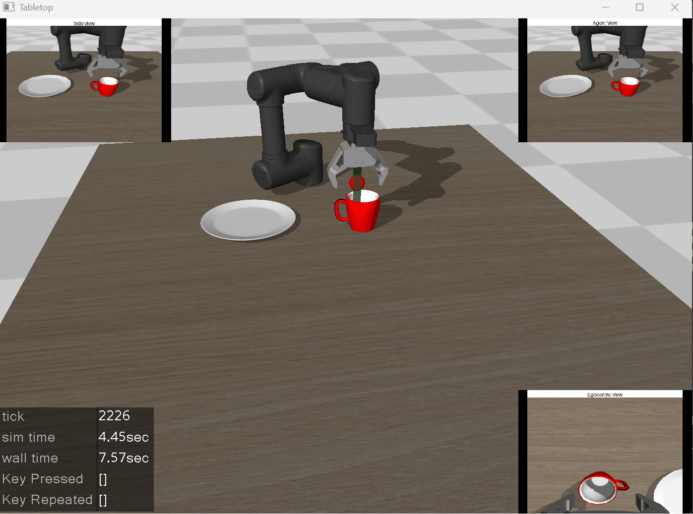
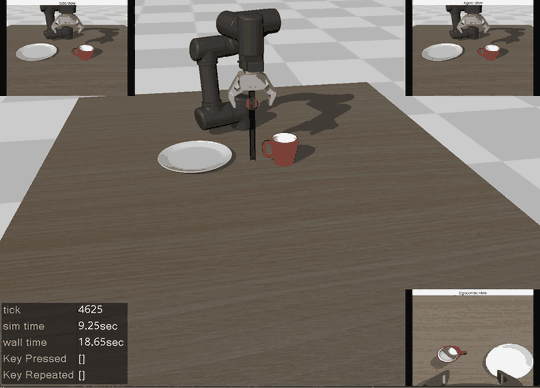
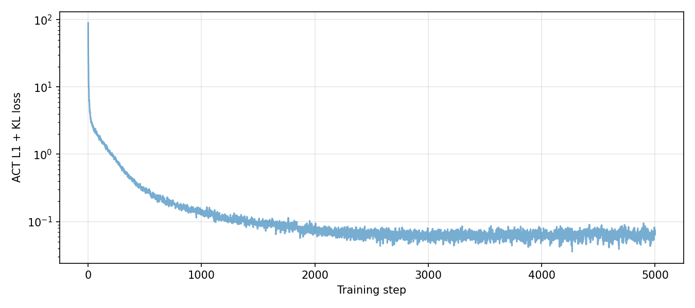
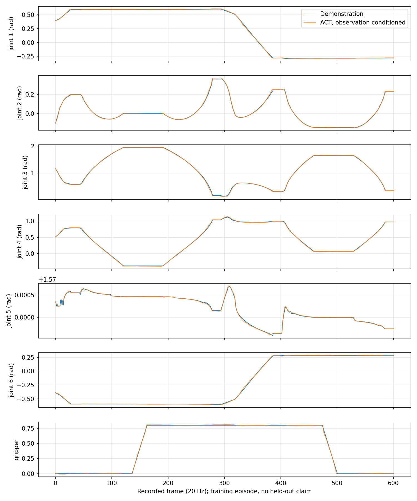
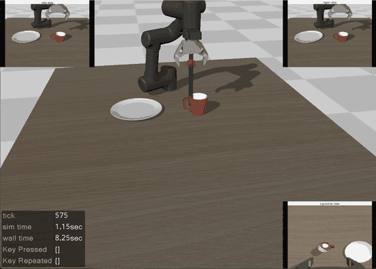

# 具身智能与 VLA 仿真实验阶段汇报

我和codex参考VLA的经典open VLA、pi模型开源资料，从本机环境配置开始，逐步完成了示教采集、数据回放、模型训练和仿真部署。目前的工作以开源场景、代码和预训练模型为基础，主要补充了独立程序入口、实验验证和记录。

目前复现项目储存在github仓库https://github.com/103xu/replica_embodied.git

## 准备阶段：先把基础环境跑起来

我先运行了机械臂抓取方块的基础演示，确认仿真能够正常启动和执行动作。随后整理项目目录，在 Windows 下复用已有的 Python 3.10 和 GPU 环境，接入 MuJoCo、LeRobot 及 OMY 机械臂资源。

为避免影响原环境，我把新增依赖、下载缓存和实验输出分开保存，并固定参考代码版本，建立 README 和复现日志。

  

机械臂抓取方块的基础演示

## 第 1 部分：实现单杯示教采集

我把教程 Notebook 中的采集流程整理成独立运行程序，接入键盘操作和图像保存。针对 Windows 调整了图像写入方式，并增加旧数据保护，避免重复运行时覆盖已有结果。

为先验证完整抓放过程，我编写并调试了脚本示教，解决夹爪接近高度不合适、杯子被推开等问题，最终采集到一条成功轨迹，共 602 帧。这里的动作来自控制脚本，尚未使用训练模型。

同时也使用键盘采集数据，以验证仿真采集能力。

  

键盘采集演示

## 第 2 部分：实现数据回放并修正记录问题

我根据保存的动作重新驱动仿真，检查采集结果是否能够重现。最初虽然能回放，但机械臂位置和杯子终态存在偏差。

进一步检查后，我修正了动作准备对物理状态的影响，以及执行动作和保存动作精度不一致的问题。最终，同一台机器上的整条轨迹能够完整回放，末端位置对齐误差为 0。

  

采集demo回放演示

## 第 3 部分：接入 ACT 训练

在数据链路跑通后，我接入 ACT 模型，先完成短步训练检查，再用上一阶段的数据完成 5,000 步训练，保存模型权重、参数、损失曲线和动作对比结果。

同时，我修正了评估时可能把未来真实动作传给模型的问题，确保推理只使用当前观察。这个阶段完成了从数据文件到可重新加载模型的训练流程。

  

training_loss

  

预测动作与示教动作对比

## 第 4 部分：让 ACT 独立控制机械臂

我编写了模型加载和仿真部署入口。最初的 10 步预测窗口配置虽然离线误差较低，但实际运行时机械臂停在杯子上方，没有完成抓放。

随后，我保留失败对照，在已有权重上改用 100 步预测窗口继续训练 2,000 步，最终完成单杯抓取和放置，并通过有窗口、无窗口验证。部署过程中没有回放示教动作，也没有让脚本接管。

这一阶段还修复了窗口显示与相机渲染上下文冲突的问题，保证模型看到的图像正常。

  

ACT 独立控制机械臂完成抓杯、搬运和放置

## 第 5 部分：扩展到红、蓝双杯语言任务

在单杯实验基础上，我接入双杯场景和两种任务指令，调整夹爪控制接口，分别记录图像、关节状态、动作和任务文字。

最终采集了 20 条脚本示教，共 12,782 帧，红杯和蓝杯各 10 条；每组使用相同初始位置，分别完成不同目标的示范。

## 第 6 部分：回放并核对语言任务数据

我分别回放两种指令对应的轨迹，核对实际操作的杯子是否与任务标签一致，并检查保存状态与回放状态是否对齐。

这一步跑通了双杯数据读取与回放，关节状态对齐误差为 0。同时，我把单杯实验的末端位姿数据与双杯实验的关节状态数据分开处理，避免后续模型接错输入。

【图片占位：红杯、蓝杯任务的指令与回放画面对比。】

## 第 7 部分：检查 π0 的训练条件

我接入了 π0 的源码和配置，并补做真实模型导入、访问权限和资源检查，修复了固定版代码中的错误类型导入。

目前完整训练仍未开展：PaliGemma 分词器访问返回 401，当前没有可用授权凭据；按教程配置估算的训练显存也超过本机约 8GB 的容量。这部分保留了检查结果，没有记作训练成功。

## 第 8 部分：完成 SmolVLA 微调与部署实验

我先接入通用预训练权重，验证参数确实加载、训练后发生更新、模型能够保存和重新加载。随后进行了 2,000 步短窗口微调，以及在此基础上的 3,000 步长窗口续训。两组程序都能完成训练和部署，但自训模型仍未完成抓放。

为了检查运行接口，我另外部署了教程发布的 OMY 微调权重。最初也没有成功，排查后发现夹爪映射、积分器和相机处理方式与原训练环境不一致。

我逐项对齐这些接口，包括恢复“800×600 渲染后缩放到 256×256”的相机流程。完成适配后，公开权重在有窗口和无窗口模式下，红杯、蓝杯任务均达到物理成功 2/2，杯子保持竖直。

这里的成功来自教程发布的微调权重，与自己训练的模型结果分开记录。

【GIF 占位：教程公开 SmolVLA 权重分别执行红杯、蓝杯指令的成功过程。】

## 第 9 部分：补充物理评价和整体复查

我增加了实际抬升、目标放置、杯子竖直和连续稳定的检查，避免只凭位置接近就判成功。完整审计发现，20 条示教虽然都通过原抓放检查，但只有 12 条满足额外的竖直放置要求，数据质量仍需改善。

同时，我补充了回归测试和一键复查程序。目前已重新执行 18 个主要环节，20 项本地测试、6 项接口测试通过，ACT 与公开 SmolVLA 的成功结果也得到再次验证。XR 扩展保留了源码，尚未进行设备验证。

## 第 10 部分：完成 π0.5 数据准备

我单独建立 Python 3.12 数据测试环境，将新采集并回放通过的单杯数据转换为 LeRobot v3 格式，完成 602 帧数据的动作窗口对齐检查。

这部分已完成数据转换和接口测试，尚未进行完整模型微调。后续还需要适配 GPU 训练环境、解决 Windows 依赖冲突，并满足相应的显存条件。

目前进展与下一步

目前已经形成了从环境搭建、示教采集、数据检查，到模型训练、保存和部署的完整本地实验流程；ACT 自训模型和教程公开 SmolVLA 权重已有实际抓放结果，代码、指导、日志和演示文件已整理到项目中。

下一步优先改善示教质量，增加初始位置变化，继续解决自训 SmolVLA 的连续执行问题，再开展更多回合的评估。现有成功结果主要来自固定场景，尚不能说明模型具有广泛泛化能力。

参考教程：[Every-Embodied](https://github.com/datawhalechina/every-embodied)

项目代码：[replica_embodied](https://github.com/103xu/replica_embodied)
